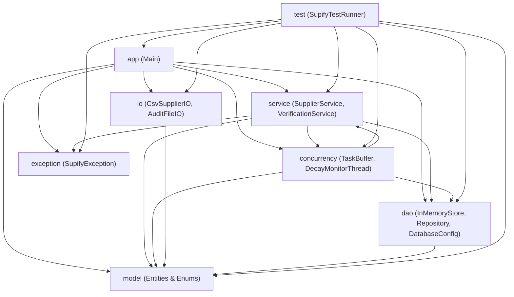
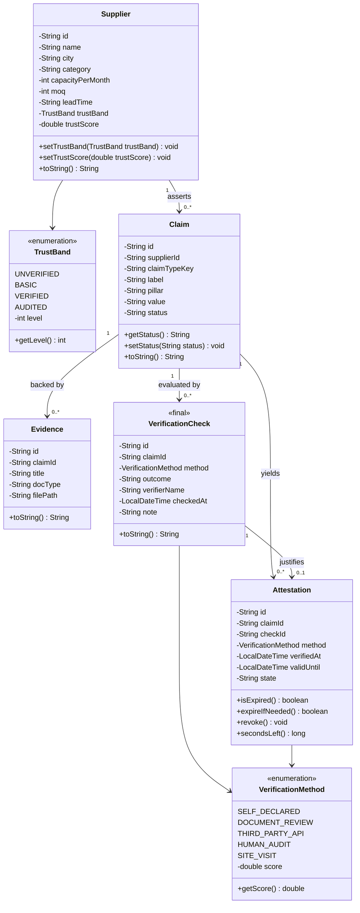
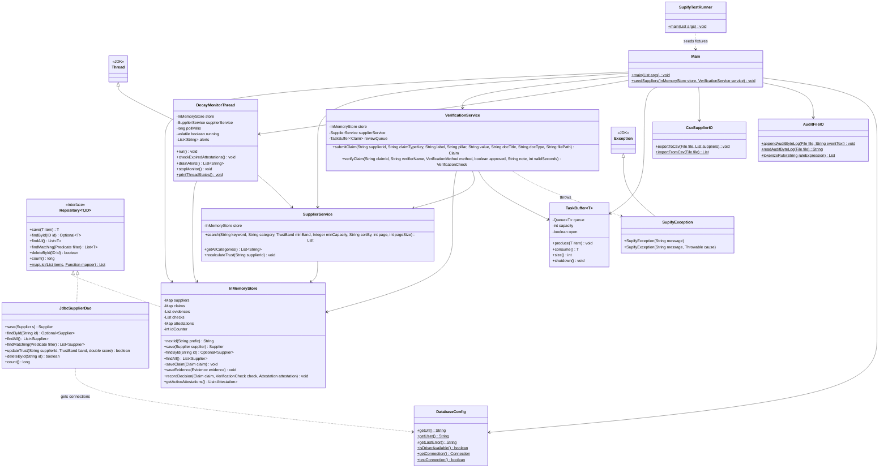
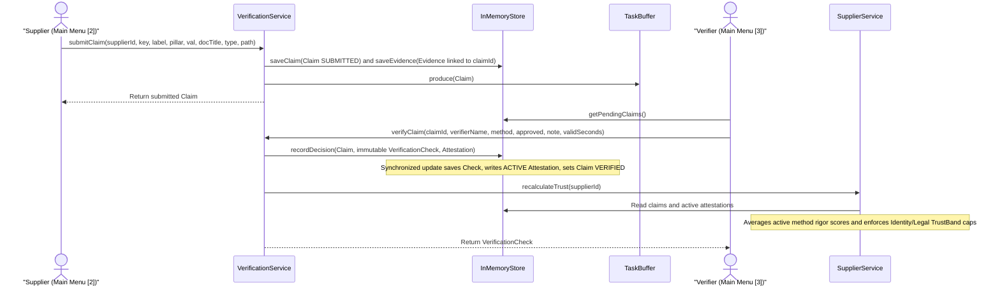
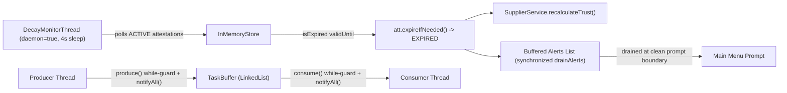
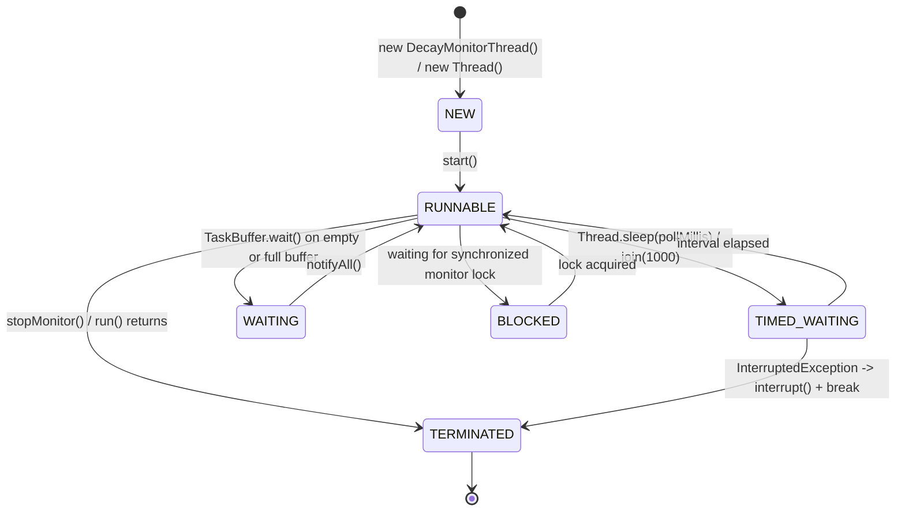
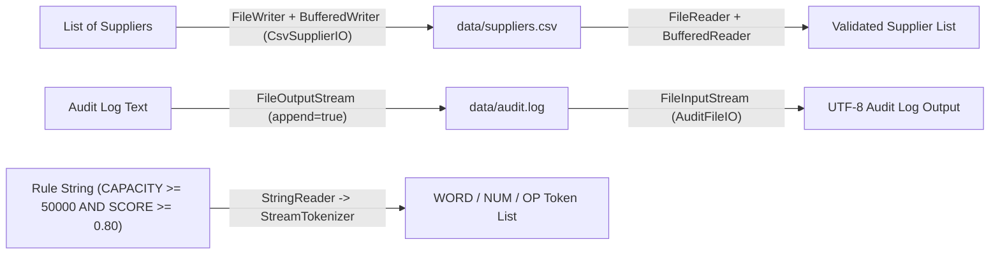

# Supify — Java Backend Architecture, UML Class Diagrams & Flowcharts

Technical architecture reference for the 20-file pure-Java backend under `backend/src/com/supify/`.  
See [`setup.md`](setup.md) to run locally, [`understanding.md`](understanding.md) for domain axioms, [`database-architecture.md`](database-architecture.md) for the MySQL 8.0 ER diagram, and [`backend/README.md`](../backend/README.md) for setup and execution instructions.

---

## 1. System Overview & Layered Package Architecture

The backend organizes terminal interaction (`app`), business workflows (`service`), data persistence (`dao`), background concurrency (`concurrency`), file I/O (`io`), and domain errors (`exception`) into 8 focused packages. Services and repositories expose clear contracts (`Repository<T, ID>`), allowing `InMemoryStore` and `JdbcSupplierDao` to share the same `Supplier` domain model.

### Package Inventory (`backend/src/com/supify/`)

| Package | Role | Classes |
| :--- | :--- | :--- |
| `app` | Interactive CLI menus (Buyer, Supplier, Verifier, System & Admin), seed data, shutdown hook | `Main` |
| `model` | 4-layer verification spine entities & enums | `Supplier`, `Claim`, `Evidence`, `VerificationCheck`, `Attestation`, `TrustBand`, `VerificationMethod` |
| `dao` | Generic repository contract, in-memory store, MySQL JDBC config & CRUD DAO | `Repository`, `InMemoryStore`, `DatabaseConfig`, `JdbcSupplierDao` |
| `service` | Stream search, trust calculation & capping, claim intake & decision orchestration | `SupplierService`, `VerificationService` |
| `concurrency` | Wait/notify task queue & background expiry monitor daemon | `TaskBuffer`, `DecayMonitorThread` |
| `io` | CSV character streams, byte-stream audit log & rule tokenizer | `CsvSupplierIO`, `AuditFileIO` |
| `exception` | Checked domain exception | `SupifyException` |
| `test` | Self-contained 10-group verification test suite | `SupifyTestRunner` |

---

## 2. Core Domain Model & 4-Layer Spine — UML Class Diagram

Supify models trust as a **4-layer evidence spine** (`Claim → Evidence → VerificationCheck → Attestation`) rather than a single boolean flag. `VerificationCheck` is a `final` immutable record with no setters, while `Attestation` carries explicit `validUntil` bounds that expire automatically over time.

---

## 3. Data Access, Services, Concurrency, I/O & Exceptions — UML Class Diagram

Generic interfaces (`Repository<T, ID>`), storage implementations (`InMemoryStore`, `JdbcSupplierDao`), business services (`SupplierService`, `VerificationService`), concurrency primitives (`TaskBuffer<T>`, `DecayMonitorThread`), file I/O (`CsvSupplierIO`, `AuditFileIO`), and checked exception (`SupifyException`).

---

## 4. End-to-End Verification Spine & Trust Recalculation Sequence

### Trust Evaluation Capping Rules

`SupplierService.recalculateTrust(String supplierId)` counts only **`ACTIVE`** attestations (`Attestation.state == "ACTIVE"`) and enforces these gating rules:
1. No active `IDENTITY` attestation → capped at **`UNVERIFIED`** (`score ≤ 0.30`).
2. Active `IDENTITY`, but no active `LEGAL` attestation → capped at **`BASIC`** (`score ≤ 0.65`).
3. Both present, plus at least one high-rigor check (`HUMAN_AUDIT` or `SITE_VISIT`), and weighted average `score ≥ 0.85` → **`AUDITED`**.
4. Otherwise → **`VERIFIED`**.

---

## 5. Concurrency, Thread Lifecycle & File I/O Pipelines

### JVM Thread States Tracked (`DecayMonitorThread.printThreadStates`)

### File I/O & Rule Parsing Pipelines

