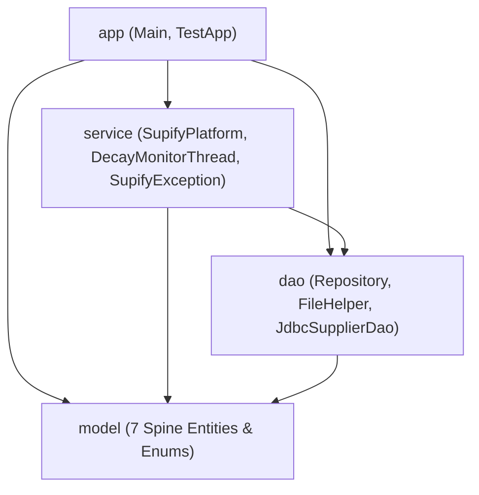
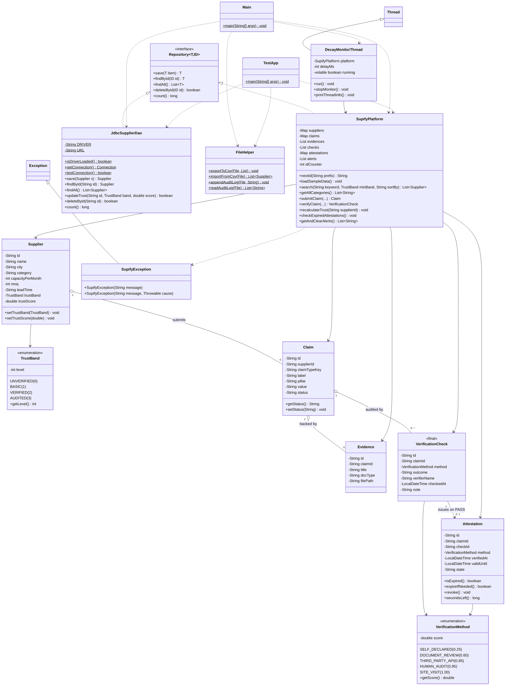
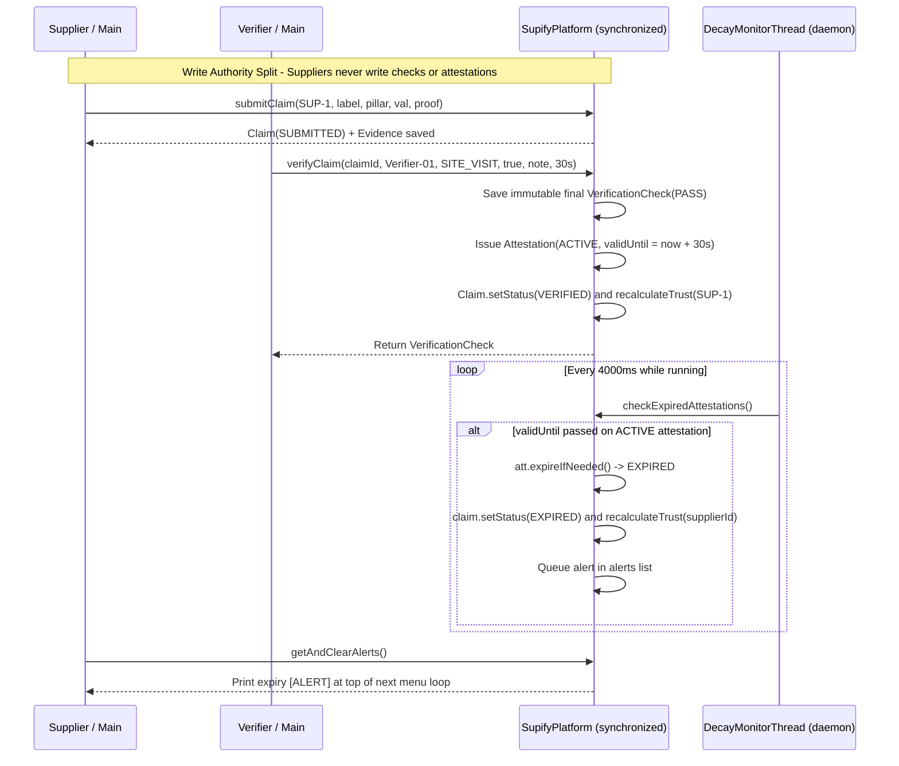

# Supify — Java Backend Architecture

Architecture summary for the 15-file pure-Java backend under `backend/src/com/supify/` (**4 packages**: `model`, `dao`, `service`, `app`).

---

## 1. 4-Package Architecture



| Package | Files | Role |
| :--- | :--- | :--- |
| `com.supify.model` | `TrustBand`, `VerificationMethod`, `Supplier`, `Claim`, `Evidence`, `VerificationCheck`, `Attestation` | 4-layer verification spine & enums |
| `com.supify.dao` | `Repository<T, ID>`, `FileHelper`, `JdbcSupplierDao` | Generic CRUD contract, CSV/log File I/O, MySQL JDBC CRUD |
| `com.supify.service` | `SupifyException`, `SupifyPlatform`, `DecayMonitorThread` | Custom checked exception, shared synchronized platform (storage, Stream search, trust rules), daemon thread |
| `com.supify.app` | `Main`, `TestApp` | Interactive console menus and 8 automated checks |

---

## 2. Complete UML Class Diagram (15 Files)



---

## 3. Verification Spine, Authority Split & Background Decay Sequence



---

## 4. Concurrency, File I/O & Trust Calculation Rules

### Concurrency & Synchronization
- **Shared Monitor (`SupifyPlatform`):** All state mutations and snapshots (`nextId`, `save`, `findAll`, `submitClaim`, `verifyClaim`, `recalculateTrust`, `checkExpiredAttestations`, `getAndClearAlerts`) are `synchronized` on the shared `SupifyPlatform` instance, preventing race conditions between the `main` interactive thread and the `DecayMonitor` thread.
- **Model-Level Synchronization & Volatile Signal:** `DecayMonitorThread` uses `setDaemon(true)` and `volatile boolean running = true` for immediate cross-thread stop visibility (`stopMonitor()` sets `running = false` and calls `interrupt()`). Mutable status fields on `Attestation`, `Claim`, and `Supplier` also synchronize their state transitions (`expireIfNeeded()`, `revoke()`, `setStatus()`, `setTrustBand()`).

### Trust Calculation & Capping (`SupifyPlatform.recalculateTrust`)
Only **`ACTIVE`** attestations contribute to trust:

```text
avgScore = min(1.0, sum(method.getScore()) / max(3, activeCount))
```

| Active Pillar / Audit Condition | Resulting `TrustBand` | Score Rule |
| :--- | :--- | :--- |
| Missing active `IDENTITY` attestation | `UNVERIFIED` | Capped at `<= 0.30` |
| Active `IDENTITY`, missing active `LEGAL` | `BASIC` | Capped at `<= 0.65` |
| Active `IDENTITY` + `LEGAL`, plus `HUMAN_AUDIT`/`SITE_VISIT` and `avgScore >= 0.85` | `AUDITED` | Computed `avgScore` |
| Active `IDENTITY` + `LEGAL` (otherwise) | `VERIFIED` | Computed `avgScore` |

### Character File I/O (`FileHelper`)
- **CSV Export (`exportToCsv`):** Writes `List<Supplier>` via `BufferedWriter(new FileWriter(file))` inside `try-with-resources`, sanitizing commas (`clean()`) so fields stay column-aligned.
- **CSV Import (`importFromCsv`):** Reads `data/suppliers.csv` via `BufferedReader(new FileReader(file))`, skips the header and blank lines, splits fields, and wraps `Integer.parseInt` / `Double.parseDouble` / `TrustBand.valueOf` in a row-level `catch (IllegalArgumentException)` so bad lines are skipped gracefully.
- **Append Audit Log (`appendAuditLog` / `readAuditLog`):** Uses `new FileWriter(file, true)` inside `BufferedWriter` to append timestamped audit lines to `data/audit.log` without overwriting earlier history.
