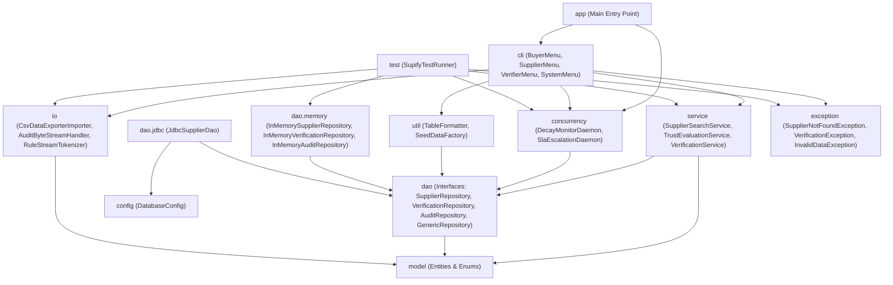
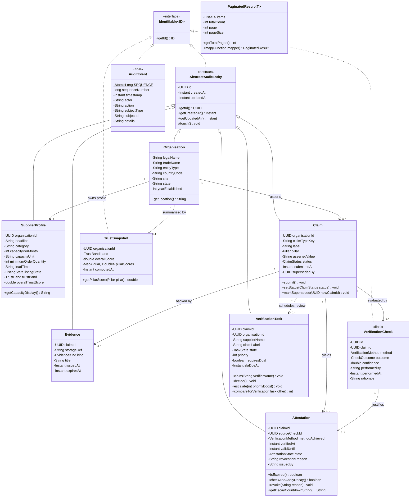
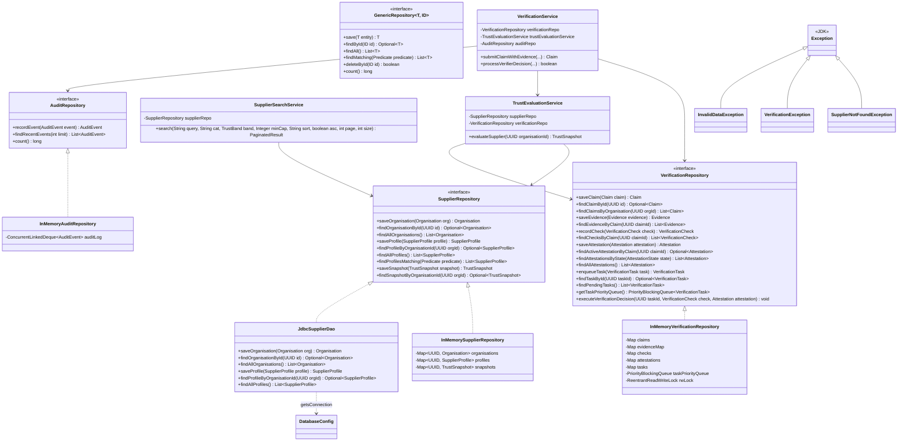
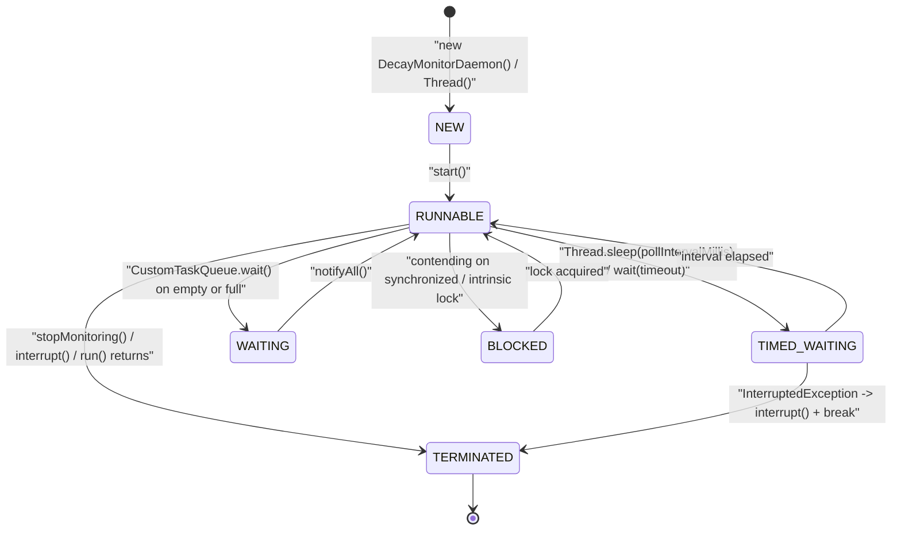
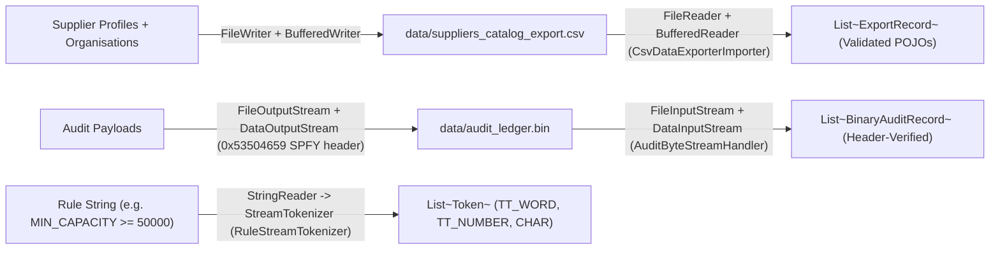

# Supify — Java Backend Architecture, UML Class Diagrams & Flowcharts

Comprehensive technical reference for the pure-Java backend under `backend/src/com/supify/`.  
For problem framing and domain axioms, see [`understanding.md`](understanding.md); for compilation and CLI usage, see [`backend/README.md`](../backend/README.md).

---

## 1. System Overview & Layered Package Architecture

The backend isolates interactive terminal I/O (`cli`), business logic (`service`), data persistence (`dao`), and concurrency workers (`concurrency`) behind repository interfaces (`SupplierRepository`, `VerificationRepository`, `AuditRepository`). Dependencies flow downward so `InMemory*` repositories and `JdbcSupplierDao` are interchangeable without changing `service` or `cli`.



### Package Inventory (`backend/src/com/supify/`)

| Package | Role | Key Classes |
| :--- | :--- | :--- |
| `app` | Application bootstrap & graceful shutdown | `Main` |
| `cli` | Interactive ANSI consoles & role session state | `ConsoleView`, `SessionContext`, `BuyerMenu`, `SupplierMenu`, `VerifierMenu`, `SystemMenu` |
| `service` | Domain pipelines & trust scoring | `SupplierSearchService`, `TrustEvaluationService`, `VerificationService` |
| `dao` | Repository contracts & implementations | `GenericRepository`, `SupplierRepository`, `VerificationRepository`, `AuditRepository`, `InMemory*`, `JdbcSupplierDao` |
| `model` | 4-layer verification spine entities & enums | `Organisation`, `SupplierProfile`, `Claim`, `Evidence`, `VerificationCheck`, `Attestation`, `VerificationTask`, `TrustSnapshot`, `AuditEvent`, `PaginatedResult` |
| `concurrency` | Background daemons, wait/notify queue & alert bridge | `DecayMonitorDaemon`, `SlaEscalationDaemon`, `CustomTaskQueue`, `AlertBuffer`, `ThreadLifecycleMonitor` |
| `io` | Character/byte file streams & rule tokenizer | `CsvDataExporterImporter`, `AuditByteStreamHandler`, `RuleStreamTokenizer` |
| `exception` | Checked domain exception hierarchy | `SupplierNotFoundException`, `VerificationException`, `InvalidDataException` |
| `config` | JDBC connection configuration | `DatabaseConfig` |
| `util` | Seed fixtures & terminal table rendering | `SeedDataFactory`, `TableFormatter` |
| `test` | Zero-dependency automated test runner | `SupifyTestRunner` |

---

## 2. Core Domain Model — UML Class Diagram

Supify models verification as a **4-layer evidence spine** (`Claim -> Evidence -> VerificationCheck -> Attestation`) rather than a single boolean flag. Mutable entities extend `AbstractAuditEntity` (which implements `Identifiable~UUID~`), while immutable platform facts (`VerificationCheck`, `AuditEvent`) are `final` value records.



---

## 3. Services, Repositories & Exceptions — UML Class Diagram

Services depend strictly on repository interfaces (`SupplierRepository`, `VerificationRepository`, `AuditRepository`), isolating the in-memory store from MySQL/JDBC persistence. `GenericRepository~T, ID~` demonstrates type-safe parameterized CRUD with bounded wildcards (`Predicate~? super T~`).



---

## 4. Verification Spine & Trust Recomputation Sequence

The end-to-end verification lifecycle preserves strict separation of concerns: suppliers only assert claims and upload proof; verifiers write immutable checks and time-bounded attestations atomically under `ReentrantReadWriteLock`.

```mermaid
sequenceDiagram
    actor Sup as Supplier (SupplierMenu)
    participant VS as VerificationService
    participant VR as InMemoryVerificationRepository
    participant AR as AuditRepository
    actor Ver as Verifier (VerifierMenu)
    participant TE as TrustEvaluationService

    Sup->>VS: submitClaimWithEvidence(orgId, key, label, pillar, value, evidence)
    VS->>VR: saveClaim(claim [SUBMITTED]) + saveEvidence(evidence)
    VS->>VR: enqueueTask(VerificationTask in PriorityBlockingQueue)
    VS->>AR: recordEvent("claim.submitted")
    VS-->>Sup: Return submitted Claim

    Ver->>VR: findPendingTasks() [ordered by priority & SLA]
    Ver->>VS: processVerifierDecision(taskId, verifier, method, PASS, rationale, validity)
    VS->>VR: executeVerificationDecision(taskId, immutable Check, Attestation)
    Note over VR: Acquires writeLock -> records Check, writes ACTIVE Attestation, sets Claim VERIFIED, marks Task DECIDED
    VS->>AR: recordEvent("verification.decided")
    VS->>TE: evaluateSupplier(orgId)
    Note over TE: Computes weighted pillar scores; caps TrustBand if Identity/Legal missing
    TE-->>VR: Read active attestations
    TE-->>VS: Return updated TrustSnapshot
```

### Trust Evaluation Capping Rules

`TrustEvaluationService` applies strict gating rules before assigning a `TrustBand`:
1. No active `IDENTITY` attestation $\rightarrow$ capped at **`UNVERIFIED`** (`score <= 0.30`).
2. `IDENTITY` verified, but no active `LEGAL` attestation $\rightarrow$ capped at **`BASIC`** (`score <= 0.65`).
3. Both present, plus at least one high-rigor check (`HUMAN_AUDIT` or `SITE_VISIT`) and weighted score $\ge 0.85$ $\rightarrow$ **`AUDITED`**.
4. Otherwise $\rightarrow$ **`VERIFIED`**.

---

## 5. Concurrency, Background Daemons & Thread Lifecycle

Background daemons keep trust scores accurate over time without corrupting active terminal prompts.


### JVM Thread States Tracked (`ThreadLifecycleMonitor`)



---

## 6. File I/O & Stream Pipelines

`SystemMenu` demonstrates three Java I/O mechanisms writing and validating data under `backend/data/`:



---

## 7. Next Phase: Database (`db/`) & JDBC Transition

The repository layer is already decoupled so migrating from in-memory maps to MySQL 8.0 requires zero changes to `cli/` or `service/`:

1. **SQL Scripts (`db/`):**
   - `db/schema/` — `CREATE TABLE` DDL for the 15 normalized tables (`organisation`, `supplier_profile`, `claim`, `evidence`, `verification_check`, `attestation`, `verification_task`, `trust_snapshot`, `audit_event`, etc.).
   - `db/seeds/` — Initial seed inserts matching the canonical fixtures.
   - `db/procedures/` — Stored procedures, views, and triggers for ledger append guarantees and trust rollups.
   - `db/migrations/` — Incremental `ALTER TABLE` scripts.
2. **Java JDBC Layer (`backend/src/com/supify/dao/jdbc/` & `config/`):**
   - Place `mysql-connector-j-*.jar` in `backend/lib/` and include `-cp "bin;lib/*"` in `run.bat` and `test.bat`.
   - Complete `JdbcSupplierDao` methods (`saveSnapshot`, `findSnapshotByOrganisationId`) and add `JdbcVerificationDao` / `JdbcAuditDao` using parameterized `PreparedStatement` and `ResultSet` cursor mapping via `DatabaseConfig.getConnection()`.
   - Switch repository instantiation in `com.supify.app.Main` based on `DatabaseConfig.testConnection()`, falling back automatically to `InMemory*` when MySQL is unavailable.
