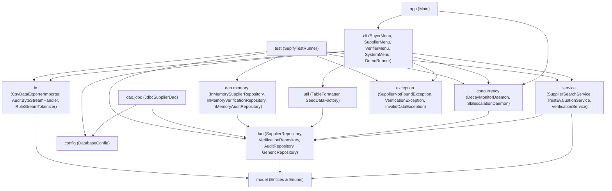
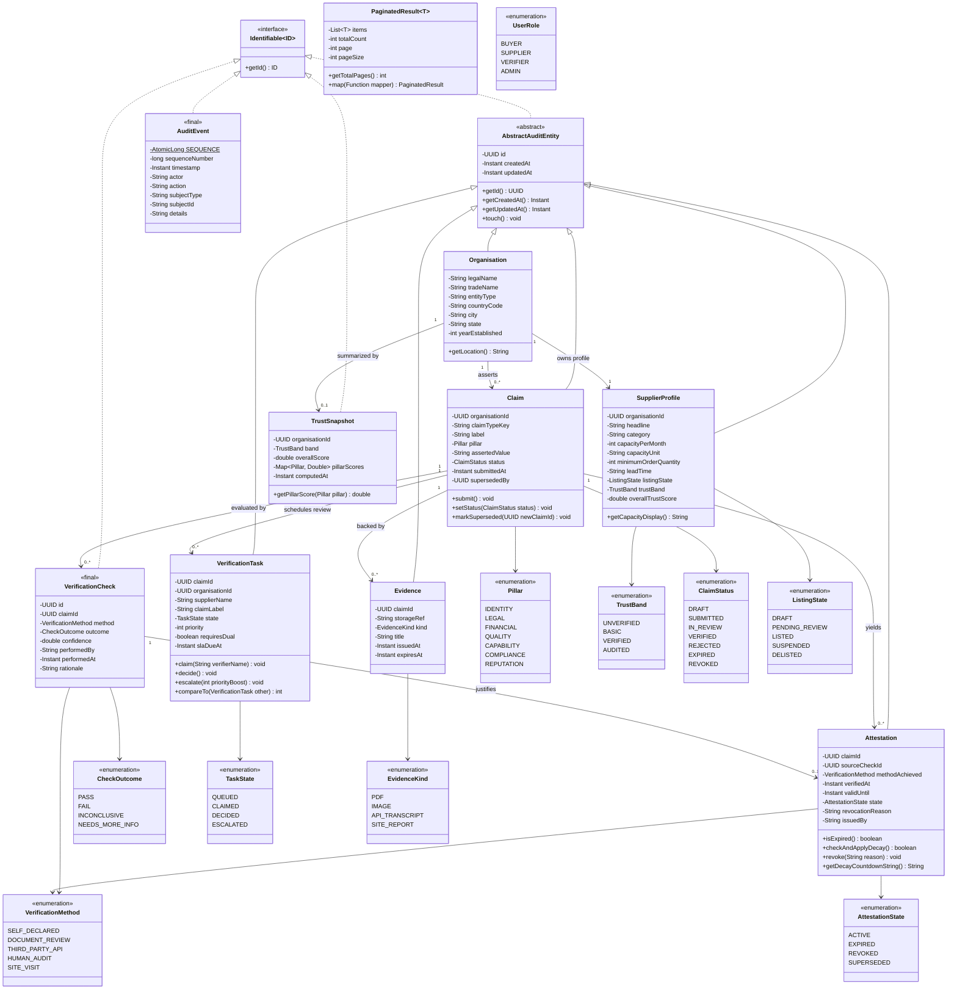
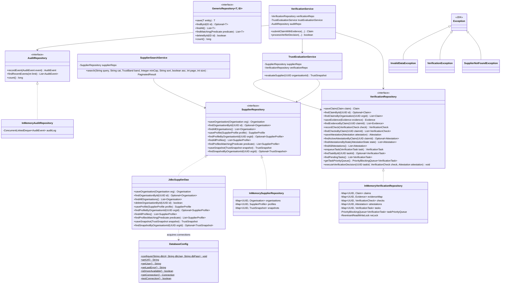
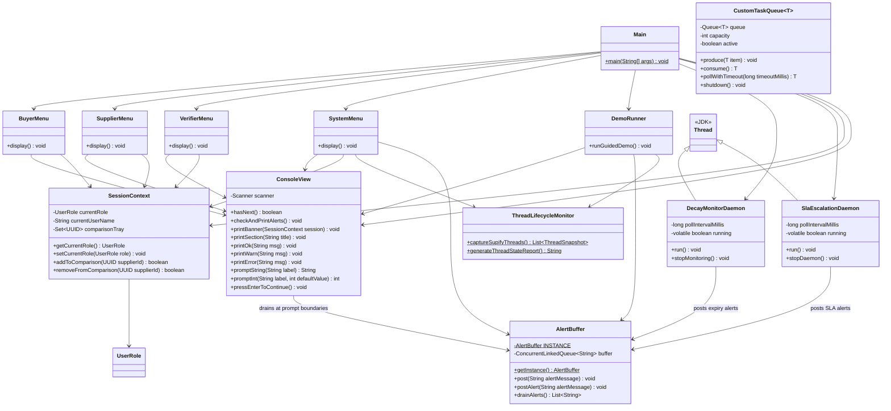
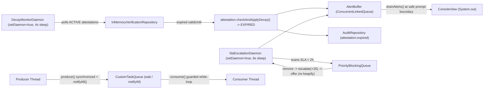
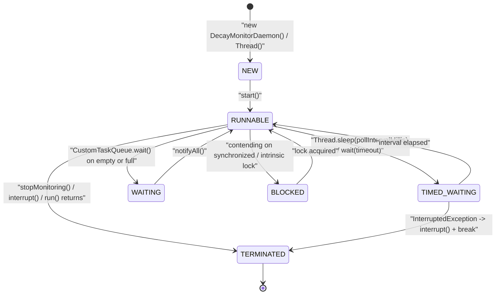

# Supify — Java Backend Architecture, UML Class Diagrams & Flowcharts

Technical architecture reference for the 56-file pure-Java backend under `backend/src/com/supify/`.  
See [`setup.md`](setup.md) to run locally, [`understanding.md`](understanding.md) for domain axioms, [`database-architecture.md`](database-architecture.md) for the MySQL 8.0 ER diagram, and [`backend/README.md`](../backend/README.md) for syllabus mapping.

---

## 1. System Overview & Layered Package Architecture

The backend isolates interactive terminal I/O (`cli`), business logic (`service`), data persistence (`dao`), and concurrency workers (`concurrency`) behind repository interfaces (`SupplierRepository`, `VerificationRepository`, `AuditRepository`). Because services depend only on interfaces, `InMemory*` repositories and `JdbcSupplierDao` are interchangeable without modifying `service` or `cli`.



### Package Inventory (`backend/src/com/supify/`)

| Package | Role | Key Classes |
| :--- | :--- | :--- |
| `app` | Application bootstrap & graceful shutdown | `Main` |
| `cli` | Pure-ASCII role consoles, session state & demo runner | `ConsoleView`, `SessionContext`, `BuyerMenu`, `SupplierMenu`, `VerifierMenu`, `SystemMenu`, `DemoRunner` |
| `service` | Stream search, trust scoring & verification orchestration | `SupplierSearchService`, `TrustEvaluationService`, `VerificationService` |
| `dao` | Repository contracts, in-memory stores & MySQL JDBC DAO | `GenericRepository`, `SupplierRepository`, `VerificationRepository`, `AuditRepository`, `InMemory*`, `JdbcSupplierDao` |
| `model` | 4-layer verification spine entities & 10 domain enums | `Organisation`, `SupplierProfile`, `Claim`, `Evidence`, `VerificationCheck`, `Attestation`, `VerificationTask`, `TrustSnapshot`, `AuditEvent`, `PaginatedResult` |
| `concurrency` | Background daemons, wait/notify queue & alert bridge | `DecayMonitorDaemon`, `SlaEscalationDaemon`, `CustomTaskQueue`, `AlertBuffer`, `ThreadLifecycleMonitor` |
| `io` | Character/byte file streams & rule tokenizer | `CsvDataExporterImporter`, `AuditByteStreamHandler`, `RuleStreamTokenizer` |
| `exception` | Checked domain exception hierarchy | `SupplierNotFoundException`, `VerificationException`, `InvalidDataException` |
| `config` | Environment-aware JDBC driver & connection settings | `DatabaseConfig` |
| `util` | Seed fixtures & ASCII table formatter | `SeedDataFactory`, `TableFormatter` |
| `test` | Zero-dependency automated test suite (22 assertions) | `SupifyTestRunner` |

---

## 2. Core Domain Model & Enums — UML Class Diagram

Supify models verification as a **4-layer evidence spine** (`Claim -> Evidence -> VerificationCheck -> Attestation`) rather than a boolean verification flag. Mutable entities inherit UUID identity and timestamps from `AbstractAuditEntity`, while audit records (`VerificationCheck`, `AuditEvent`) are immutable `final` classes.



---

## 3. Services, Repositories, JDBC Config & Exceptions — UML Class Diagram

Services depend strictly on repository interfaces (`SupplierRepository`, `VerificationRepository`, `AuditRepository`). `JdbcSupplierDao` uses `DatabaseConfig` to run parameterized MySQL CRUD queries and `TrustSnapshot` JSON serialization with zero external JSON libraries.



---

## 4. CLI Consoles & Concurrency Workers — UML Class Diagram

`Main` wires shared session state (`SessionContext`), ANSI/ASCII terminal I/O (`ConsoleView`), the four role consoles (`BuyerMenu`, `SupplierMenu`, `VerifierMenu`, `SystemMenu`), the repeatable guided walkthrough (`DemoRunner`), and two background daemon threads (`DecayMonitorDaemon`, `SlaEscalationDaemon`).



---

## 5. Verification Spine & Trust Recomputation Sequence

The end-to-end verification lifecycle preserves strict separation of concerns: `VerificationService.submitClaimWithEvidence` binds uploaded proof to the newly generated `claim.getId()` and enqueues a review task, while verifiers write immutable checks and time-bounded attestations atomically under `ReentrantReadWriteLock`.

```mermaid
sequenceDiagram
    actor Sup as Supplier (SupplierMenu)
    participant VS as VerificationService
    participant VR as InMemoryVerificationRepository
    participant AR as AuditRepository
    actor Ver as Verifier (VerifierMenu)
    participant TE as TrustEvaluationService

    Sup->>VS: submitClaimWithEvidence(orgId, supplierName, key, label, pillar, value, evidence)
    VS->>VR: saveClaim(claim [SUBMITTED]) + saveEvidence(evidence linked to claimId)
    VS->>VR: enqueueTask(VerificationTask in PriorityBlockingQueue)
    VS->>AR: recordEvent("claim.submitted")
    VS-->>Sup: Return submitted Claim

    Ver->>VR: findPendingTasks() [ordered by priority & SLA]
    Ver->>VS: processVerifierDecision(taskId, verifier, method, PASS, rationale, validity)
    VS->>VR: executeVerificationDecision(taskId, immutable Check, Attestation)
    Note over VR: Acquires writeLock -> records Check, writes ACTIVE Attestation, sets Claim VERIFIED, marks Task DECIDED
    VS->>AR: recordEvent("verification.decided")
    VS->>TE: evaluateSupplier(orgId)
    Note over TE: Computes weighted pillar scores; caps TrustBand if Identity/Legal missing
    TE-->>VR: Read active attestations
    TE-->>VS: Return updated TrustSnapshot
```

### Trust Evaluation Capping Rules

`TrustEvaluationService` applies strict gating rules before assigning a `TrustBand`:
1. No active `IDENTITY` attestation $\rightarrow$ capped at **`UNVERIFIED`** (`score <= 0.30`).
2. `IDENTITY` verified, but no active `LEGAL` attestation $\rightarrow$ capped at **`BASIC`** (`score <= 0.65`).
3. Both present, plus at least one high-rigor check (`HUMAN_AUDIT` or `SITE_VISIT`) and weighted score $\ge 0.85$ $\rightarrow$ **`AUDITED`**.
4. Otherwise $\rightarrow$ **`VERIFIED`**.

---

## 6. Concurrency, Background Daemons & Thread Lifecycle

Background daemons keep trust scores accurate over time without corrupting active terminal prompts.



### JVM Thread States Tracked (`ThreadLifecycleMonitor`)



---

## 7. File I/O & Stream Pipelines

`SystemMenu` exercises three Java I/O mechanisms writing and validating files under `backend/data/`:


---

## 8. Database (`db/`) & JDBC Status

See [`database-architecture.md`](database-architecture.md) for the complete 9-table ER diagram and MySQL data-flow chart.

- **Implemented now:**
  - `db/schema/01_supify_schema.sql`, `db/seeds/01_canonical_suppliers.sql`, `db/procedures/01_views_and_procedures.sql`, and `db/setup_mysql.bat`.
  - `DatabaseConfig` supporting `SUPIFY_DB_*` env vars, `-Dsupify.db.*` properties, driver detection (`isDriverAvailable()`), and live connection diagnostics (`SystemMenu` option `[6]`).
  - Full-CRUD `JdbcSupplierDao` (`organisation`, `supplier_profile`, and `trust_snapshot` persistence via `PreparedStatement` + `ResultSet`).
  - `backend/run.bat` and `backend/test.bat` wired with `-cp "bin;lib\*"`.
- **Next increment:**
  - Add `JdbcVerificationDao` and `JdbcAuditDao` implementing `VerificationRepository` and `AuditRepository`.
  - Switch repository instantiation in `com.supify.app.Main` based on a `--db` flag or `DatabaseConfig.testConnection()`, falling back cleanly to `InMemory*` when offline.
