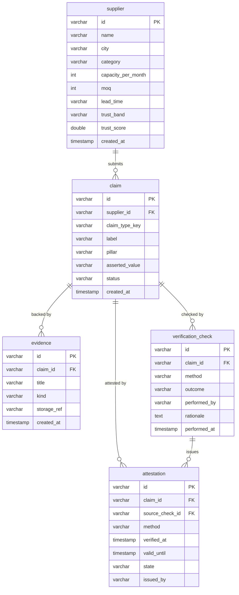
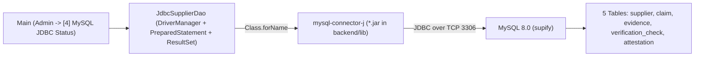

# Supify — MySQL 8.0 ER Diagram & JDBC Data Flow

Relational database specification for [`db/`](../db/README.md) and [`backend/`](../backend/README.md).

---

## 1. Entity–Relationship Diagram (5 Basic InnoDB Tables = 1:1 with Java Models)

Matches [`db/schema/01_supify_schema.sql`](../db/schema/01_supify_schema.sql). Each table corresponds directly to one class in `backend/src/com/supify/model/` (`Supplier`, `Claim`, `Evidence`, `VerificationCheck`, `Attestation`).

---

## 2. Java-to-MySQL Mapping & JDBC Execution Flow

| Java Component | MySQL Target / Operation | Purpose |
| :--- | :--- | :--- |
| `JdbcSupplierDao.getConnection()` | `Class.forName("com.mysql.cj.jdbc.Driver")` + `DriverManager.getConnection` | Opens TCP JDBC connection to `supify` (reads optional `SUPIFY_DB_PASS`) |
| `JdbcSupplierDao.save(Supplier)` | `findById` → `deleteById` → parameterized `INSERT INTO supplier ...` | Upserts a supplier row using `PreparedStatement` (`?` binding) and `executeUpdate()` |
| `JdbcSupplierDao.findById(String)` | `SELECT ... FROM supplier WHERE id = ?` | `executeQuery()` + `if (rs.next())` + `mapRow(rs)` |
| `JdbcSupplierDao.findAll()` | `SELECT ... FROM supplier ORDER BY trust_score DESC` | `executeQuery()` + `while (rs.next())` + `mapRow(rs)` |
| `JdbcSupplierDao.updateTrust(...)` | `UPDATE supplier SET trust_band = ?, trust_score = ? WHERE id = ?` | Updates computed trust standing safely |
| `JdbcSupplierDao.deleteById(String)` | `DELETE FROM supplier WHERE id = ?` | Removes supplier (cascades to `claim` → `evidence`, `verification_check`, `attestation`) |
| `JdbcSupplierDao.count()` | `SELECT COUNT(*) FROM supplier` | Reads scalar `rs.getLong(1)` |

---

## 3. Domain Invariants in the Schema

- **No boolean verification flag:** `supplier` has no `is_verified` column; standing is explicitly stored as `trust_band` + `trust_score` alongside full audit evidence.
- **Referential integrity (`FOREIGN KEY`):** `claim`, `evidence`, `verification_check`, and `attestation` cascade cleanly when a parent `supplier`/`claim` is deleted (`ON DELETE CASCADE`), while `attestation.source_check_id` uses `ON DELETE RESTRICT` so an issued attestation cannot lose its underlying check.
- **Explicit method, rationale, and expiry:** Every check records `method`, `outcome`, `performed_by`, and `rationale`; every attestation records `verified_at`, `valid_until`, `state`, and `issued_by`.
