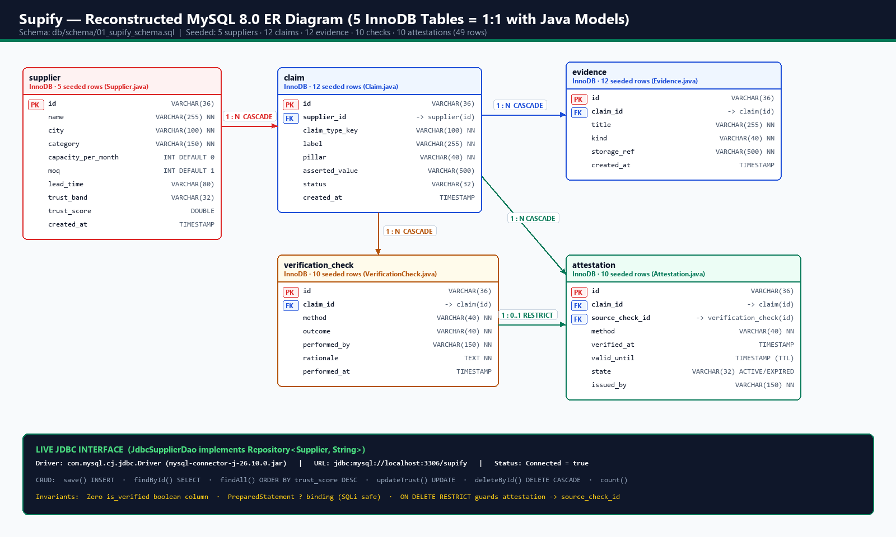
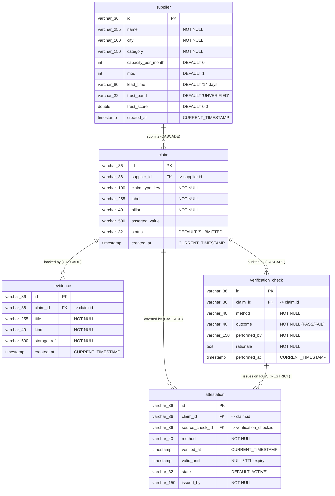
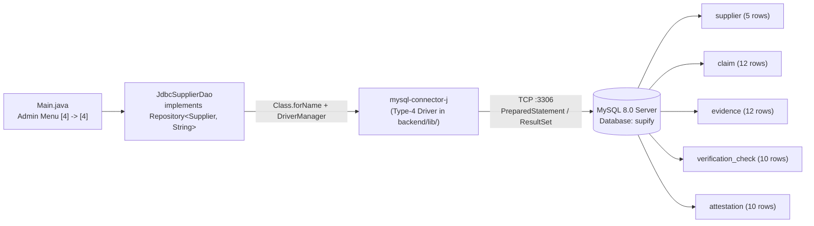
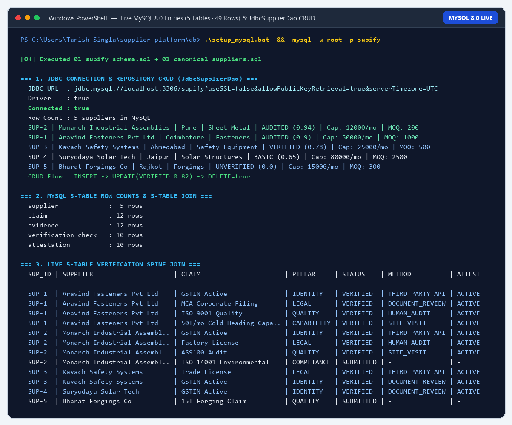

# Supify — MySQL 8.0 ER Diagram, Live DB Entries & JDBC Data Flow

Relational database specification for [`db/`](../db/README.md) and [`backend/`](../backend/README.md).

---

## 1. Reconstructed Entity–Relationship Diagram (5 InnoDB Tables = 1:1 with Java Models)

Matches [`db/schema/01_supify_schema.sql`](../db/schema/01_supify_schema.sql). Each InnoDB table corresponds 1:1 to a domain entity class in `backend/src/com/supify/model/` (`Supplier`, `Claim`, `Evidence`, `VerificationCheck`, `Attestation`).

---

## 2. JDBC Connection & Execution Architecture

### JDBC Configuration (`JdbcSupplierDao.java`)
- **Driver Class:** `com.mysql.cj.jdbc.Driver` (MySQL Connector/J Type-4 JAR in `backend/lib/`)
- **Connection URL:** `jdbc:mysql://localhost:3306/supify?useSSL=false&allowPublicKeyRetrieval=true&serverTimezone=UTC`
- **Credentials:** `USER = "root"`, `PASS = System.getenv("SUPIFY_DB_PASS")` (defaults to `"root"`)

| Method in `JdbcSupplierDao` | Parameterized SQL Executed | JDBC Mechanism |
| :--- | :--- | :--- |
| `isDriverLoaded()` | — | `Class.forName("com.mysql.cj.jdbc.Driver")` |
| `getConnection()` / `testConnection()` | — | `DriverManager.getConnection(URL, USER, pass)` + `!conn.isClosed()` |
| `save(Supplier s)` | `INSERT INTO supplier (id, name, city, category, capacity_per_month, moq, lead_time, trust_band, trust_score) VALUES (?, ?, ?, ?, ?, ?, ?, ?, ?)` | `PreparedStatement` + `executeUpdate()` (upsert via `findById`/`deleteById`) |
| `findById(String id)` | `SELECT id, name, city, category, capacity_per_month, moq, lead_time, trust_band, trust_score FROM supplier WHERE id = ?` | `PreparedStatement` + `executeQuery()` + `if (rs.next()) mapRow(rs)` |
| `findAll()` | `SELECT ... FROM supplier ORDER BY trust_score DESC` | `PreparedStatement` + `executeQuery()` + `while (rs.next()) mapRow(rs)` |
| `updateTrust(id, band, score)` | `UPDATE supplier SET trust_band = ?, trust_score = ? WHERE id = ?` | `PreparedStatement` + `executeUpdate() > 0` |
| `deleteById(String id)` | `DELETE FROM supplier WHERE id = ?` | `PreparedStatement` + `executeUpdate() > 0` (cascades child rows) |
| `count()` | `SELECT COUNT(*) FROM supplier` | `PreparedStatement` + `executeQuery()` + `rs.getLong(1)` |

---

## 3. Seeded Database Entries (`db/seeds/01_canonical_suppliers.sql`)

Total seeded dataset across all 5 tables: **49 rows** (`5` suppliers · `12` claims · `12` evidence records · `10` checks · `10` attestations).

### Table 1: `supplier` (5 Rows)

| `id` | `name` | `city` | `category` | `capacity_per_month` | `moq` | `lead_time` | `trust_band` | `trust_score` |
| :--- | :--- | :--- | :--- | ---: | ---: | :--- | :--- | ---: |
| `SUP-1` | Aravind Fasteners Pvt Ltd | Coimbatore | Fasteners | 50,000 | 1,000 | 14 days | `AUDITED` | 0.90 |
| `SUP-2` | Monarch Industrial Assemblies | Pune | Sheet Metal | 12,000 | 200 | 21 days | `AUDITED` | 0.94 |
| `SUP-3` | Kavach Safety Systems | Ahmedabad | Safety Equipment | 25,000 | 500 | 10 days | `VERIFIED` | 0.78 |
| `SUP-4` | Suryodaya Solar Tech | Jaipur | Solar Structures | 80,000 | 2,500 | 18 days | `BASIC` | 0.65 |
| `SUP-5` | Bharat Forgings Co | Rajkot | Forgings | 15,000 | 300 | 15 days | `UNVERIFIED` | 0.00 |

### 5-Table Verification Spine Join (`supplier ⋈ claim ⟕ evidence ⟕ verification_check ⟕ attestation`)

| `supplier.id` | `claim.id` | `claim.label` | `pillar` | `claim.status` | `evidence.storage_ref` | `verification_check.method` | `attestation.state` |
| :--- | :--- | :--- | :--- | :--- | :--- | :--- | :--- |
| `SUP-1` | `CLM-1` | GSTIN Active | `IDENTITY` | `VERIFIED` | `gst.pdf` | `THIRD_PARTY_API` | `ACTIVE` (180d) |
| `SUP-1` | `CLM-2` | MCA Corporate Filing | `LEGAL` | `VERIFIED` | `coi.pdf` | `DOCUMENT_REVIEW` | `ACTIVE` (180d) |
| `SUP-1` | `CLM-3` | ISO 9001 Quality | `QUALITY` | `VERIFIED` | `iso.pdf` | `HUMAN_AUDIT` | `ACTIVE` (180d) |
| `SUP-1` | `CLM-4` | 50T/mo Cold Heading Capacity | `CAPABILITY` | `VERIFIED` | `site.pdf` | `SITE_VISIT` | `ACTIVE` (35s demo TTL) |
| `SUP-2` | `CLM-5` | GSTIN Active | `IDENTITY` | `VERIFIED` | `m_gst.pdf` | `THIRD_PARTY_API` | `ACTIVE` (180d) |
| `SUP-2` | `CLM-6` | Factory License | `LEGAL` | `VERIFIED` | `m_lic.pdf` | `HUMAN_AUDIT` | `ACTIVE` (180d) |
| `SUP-2` | `CLM-7` | AS9100 Audit | `QUALITY` | `VERIFIED` | `m_as.pdf` | `SITE_VISIT` | `ACTIVE` (180d) |
| `SUP-2` | `CLM-8` | ISO 14001 Environmental | `COMPLIANCE` | `SUBMITTED` | `iso14001.pdf` | — *(pending)* | — |
| `SUP-3` | `CLM-9` | GSTIN Active | `IDENTITY` | `VERIFIED` | `k_gst.pdf` | `DOCUMENT_REVIEW` | `ACTIVE` (180d) |
| `SUP-3` | `CLM-10` | Trade License | `LEGAL` | `VERIFIED` | `k_lic.pdf` | `THIRD_PARTY_API` | `ACTIVE` (180d) |
| `SUP-4` | `CLM-11` | GSTIN Active | `IDENTITY` | `VERIFIED` | `s_gst.pdf` | `DOCUMENT_REVIEW` | `ACTIVE` (180d) |
| `SUP-5` | `CLM-12` | 15T Forging Claim | `QUALITY` | `SUBMITTED` | `b_brochure.pdf` | — *(pending)* | — |

---

## 4. Domain Invariants Enforced by the Schema

- **No boolean verification flag:** `supplier` never stores `is_verified`; trust standing is represented via `trust_band` + `trust_score` backed by the 4-table verification spine.
- **Referential integrity (`FOREIGN KEY`):** `claim`, `evidence`, `verification_check`, and `attestation` cascade cleanly when a parent `supplier` or `claim` is deleted (`ON DELETE CASCADE`), while `attestation.source_check_id` uses `ON DELETE RESTRICT` so an issued attestation cannot lose its underlying check record.
- **Explicit method, rationale, and expiry:** Every `verification_check` stores `method`, `outcome`, `performed_by`, and `rationale`; every `attestation` stores `verified_at`, `valid_until`, `state`, and `issued_by`.
