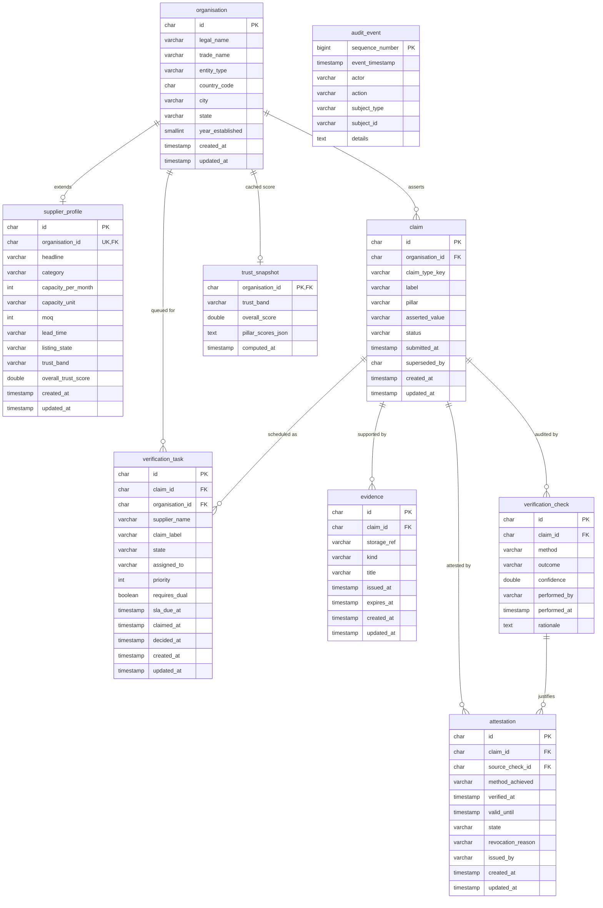
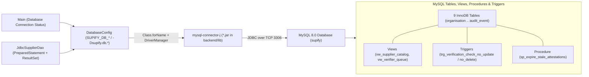

# Supify — MySQL 8.0 ER Diagram & JDBC Data-Flow Architecture

Relational schema specification and JDBC connectivity guide for [`db/`](../db/README.md) and [`backend/`](../backend/README.md).  
For domain axioms and conceptual modeling, see [`understanding.md`](understanding.md); for local setup commands, see [`setup.md`](setup.md).

---

## 1. Entity–Relationship Diagram (9 Normalized InnoDB Tables)

Matches [`db/schema/01_supify_schema.sql`](../db/schema/01_supify_schema.sql) verbatim. Write authority crosses once along the verification spine: **Supplier** writes `claim` + `evidence`; **Platform / Verifier** writes immutable `verification_check` + time-bounded `attestation`.

---

## 2. JDBC Execution & MySQL Enforcement Flow

### Active JDBC Capabilities (`backend/src/com/supify/dao/`)

- **`DatabaseConfig`**: Resolves `-Dsupify.db.*` JVM properties, then `SUPIFY_DB_*` environment variables, then local defaults (`jdbc:mysql://localhost:3306/supify?...`). Exposes `isDriverAvailable()`, `getConnection()`, `testConnection()`, `getUrl()`, `getUser()`, and `getLastError()`.
- **`JdbcSupplierDao`**: Implements `Repository<Supplier, String>` using parameterized `PreparedStatement` queries (`executeQuery()` / `executeUpdate()`) and `ResultSet` cursor row mapping (`mapRow`) across `organisation` and `supplier_profile` (`save`, `findById`, `findAll`, `findMatching`, `updateTrust`, `deleteById`, `count`).

---

## 3. Axiom-to-Schema Traceability

Every SQL table and constraint in [`db/`](../db/README.md) enforces the trust axioms from [`understanding.md`](understanding.md) §2:

| Axiom | Core Rule | MySQL Enforcement in `db/` |
| :--- | :--- | :--- |
| **A1** (Explainable Trust) | Scores derive from inspectable records | `trust_snapshot.pillar_scores_json` summarizes `attestation` + `verification_check.rationale`; no opaque score without backing rows |
| **A2** (Method Matters) | Verification carries method & rigor | `verification_check.method` and `attestation.method_achieved` distinguish `SELF_DECLARED`, `DOCUMENT_REVIEW`, `THIRD_PARTY_API`, `HUMAN_AUDIT`, `SITE_VISIT` |
| **A3** (Time-Bounded Validity) | Trust decays on expiration | `attestation.valid_until` indexed with `state`; `sp_expire_stale_attestations()` marks aged rows `EXPIRED` and logs in `audit_event`; `vw_supplier_catalog` counts only non-expired `ACTIVE` rows |
| **A5** (Append-Only Ledger) | Checks are never mutated or deleted | `trg_verification_check_no_update` and `trg_verification_check_no_delete` raise `SQLSTATE '45000'`; `claim.superseded_by` records claim replacement history |
| **A6** (Claim vs Attestation Split) | Suppliers assert; platform attests | `claim` + `evidence` are separate tables from `verification_check` + `attestation`; `fk_att_check` (`ON DELETE RESTRICT`) prevents dangling attestations without a recorded check |
| **A10** (Claims as Data) | Claim types live in data, not code | `claim.claim_type_key` (`VARCHAR(100)`) and `claim.pillar` avoid hardcoded SQL `ENUM` switches per certification |

---

## 4. Planned Next Increment

1. Add a JDBC DAO covering the remaining verification spine tables (`claim`, `evidence`, `verification_check`, `attestation`) with atomic SQL transactions (`conn.setAutoCommit(false)`).
2. Wire an optional `--db` mode (or auto-switch when `DatabaseConfig.testConnection()` returns `true`) in `com.supify.app.Main`.
