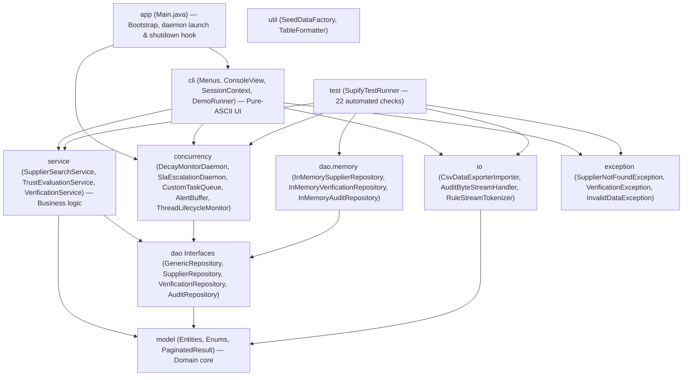
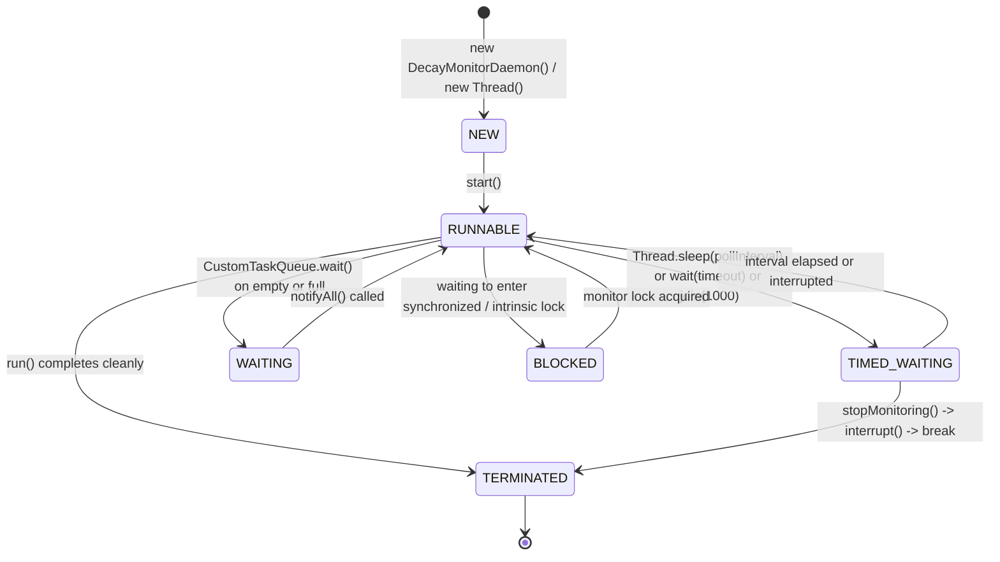

# Supify — Pure-Java Backend Architecture & Topic-Wise Viva Guide

> **Complete Topic-by-Topic Revision Book | Plain-English Definitions & Explanations + ~90 Viva Q&As**  
> Covers the entire pure-Java backend (`backend/src/com/supify/`): OOP principles & definitions, 4-layer verification spine, multithreading, thread lifecycle, synchronization, inter-thread communication, lambdas/streams, generics/collections, file I/O streams, `StreamTokenizer`, and checked exceptions — with **quick definitions**, **what each topic means in general**, **how Supify implements it**, and **why we picked every function and API**.

---

## How to Study This Guide Before Tomorrow's Viva

1. **Start with Quick Start (3 minutes)** so you know the 30-second pitch and which numbers to press in the terminal demo.
2. **Read Topics 1 to 9 in order (or jump straight to any weak topic)** — each chapter starts with **Quick Definitions**, then moves cleanly through **General Concept → Exact Supify Code → Why We Used Every Function → Spoken Viva Q&As**.
3. **Revise the 2-Minute Cheat Table** right outside the viva room so class names and exact timings roll off your tongue smoothly.

---

## Quick Start: 30-Second Pitch & Live CLI Demo Cheat Sheet

### 30-Second Viva Pitch (Say This First)

> *"Supify is a B2B supplier discovery and verification backend written in pure Java. Normally, any supplier can claim 'we hold ISO 9001' or '50-ton capacity', and a buyer cannot cheaply verify if that is true or still valid. So instead of a fake `boolean isVerified` flag, we built a **4-layer verification spine**: a Supplier submits a **Claim** with **Evidence**; an independent Verifier writes an immutable **VerificationCheck**; and on PASS, the platform issues a time-bounded **Attestation** that automatically expires in the background via daemon threads."*

Two phrases examiners love:
- **Asymmetry Razor:** *"Every feature must cut either the cost of **finding** a supplier or the cost of **trusting** one."*
- **Authority Split:** *"The supplier asserts (`Claim` + `Evidence`); the platform attests (`VerificationCheck` + `Attestation`)."*

### Pure-Java CLI Demo Cheat Sheet

From `backend\`:
- **Launch interactive CLI:** double-click or run `run.bat` (`java -cp "bin;lib\*" com.supify.app.Main`)
- **Run automated check suite:** double-click or run `test.bat` (`SupifyTestRunner` — 10 test groups, 22 `[PASS]` assertions, zero external JARs needed)

| What Examiner Asks to See | Keys to Press | What Happens Live on Screen |
| :--- | :--- | :--- |
| **"Show me the whole flow fast"** | `Main → [5]` | `DemoRunner` runs an isolated 5-step walkthrough (Stream top-3 → claim + PDF intake → verifier PASS + trust recalculation → `PriorityBlockingQueue` escalation + `AlertBuffer` → `StreamTokenizer` + thread count) without polluting your live session |
| **"Show Buyer Search & Compare"** | `Main → [1] → [1]` (then `[4]`, `[5]`) | Prints all 5 seeded Indian suppliers sorted by verified score (`Zenith` 0.940 down to `Suryodaya` 0.650), then compares up to 4 selected suppliers side by side |
| **"Show live Expiry / Decay Daemon"** | `Main → [2] → [3]` | Shows Aravind Fasteners' `"Cold Heading Production Capacity (50T/mo)"` ticking down from 35s; after ~35s, press Enter to see `[ALERT]` delivered cleanly by `DecayMonitorDaemon` via `AlertBuffer` |
| **"Show Priority Heap Escalation"** | `Main → [3] → [4]` | Picks a pending task, boosts its priority by `+35` via `remove()` → `escalate()` → `offer()`, and re-balances `PriorityBlockingQueue` immediately |
| **"Show Threads & File I/O"** | `Main → [4]` (`[1]`, `[3]`, `[4]`, `[5]`) | `[1]` Live JVM threads table, `[3]` CSV export/import round-trip, `[4]` Binary `SPFY` packet write/read, `[5]` `StreamTokenizer` rule parser |

---

## Topic 1: Problem Framing, Domain Model & 4-Layer Verification Spine

### 1.1 Quick Definitions & Real-World Analogy

- **Domain Entity:** A business object with a unique identity (`UUID` or `Long`) whose identity persists even when its attributes change (e.g., `Organisation`, `Claim`).
- **Immutable Object:** An object whose state **cannot change** after construction (`final` class, `private final` fields, no setters) — inherently thread-safe and tamper-proof (`VerificationCheck`, `AuditEvent`).
- **Value Object / DTO (`record`):** A small data carrier grouped purely by its field values rather than mutable identity (`SupplierSearchResult`, `ThreadSnapshot`, `BinaryAuditRecord`).
- **Append-Only Ledger:** A history log where new facts are only added (`AuditEvent`), never edited or deleted afterwards.
- **Time-Bounded Attestation (Decay):** A verification badge that automatically stops counting (`ACTIVE → EXPIRED`) once its validity window (`validUntil`) passes.

Think of buying industrial parts from a factory you have never visited. On a normal directory website, you might see a green badge saying **"Verified"**. That single boolean (`true`/`false`) hides every fact a buyer actually needs:
- *Which* document was checked — their tax registration, factory audit, or just an email address?
- *Who* checked it — the supplier themselves or an independent auditor?
- *When* was it checked, and has that certificate expired yet?

In software design, replacing a fragile boolean flag with an **evidenced audit trail** means separating *what someone claims* from *who proved it* and *how long that proof stays valid*.

### 1.2 How Supify Implements the 4-Layer Spine

Supify splits verification into four chained entities under `com.supify.model`:

```text
  Supplier Side (Asserts)                 Verifier / Platform Side (Attests)
  ───────────────────────────────         ─────────────────────────────────────────────
  [1] Claim (DRAFT -> SUBMITTED)    ──▶   [3] VerificationCheck (public final, immutable)
       │                                        │
       └──▶ [2] Evidence (PDF/API/Site)         └──▶ [4] Attestation (ACTIVE -> EXPIRED / REVOKED)
```

1. **Layer 1 — `Claim` (`AbstractAuditEntity` subclass):**
   - Stores `organisationId`, a data-driven `claimTypeKey` (like `"gst_registration"` or `"iso_9001"` — never a hardcoded Java `switch` per certification!), `label`, `Pillar`, `assertedValue`, `ClaimStatus`, `submittedAt`, and `supersededBy`.
   - When rejected or expired, a supplier creates a new claim and links `oldClaim.markSuperseded(newClaimId)` so old history is never erased.
2. **Layer 2 — `Evidence` (`AbstractAuditEntity` subclass):**
   - Stores proof metadata linked to a specific claim via `claimId`: `storageRef`, `EvidenceKind` (`PDF`, `IMAGE`, `API_TRANSCRIPT`, `SITE_REPORT`), `title`, `issuedAt`, and `expiresAt`.
   - Inside `VerificationService.submitClaimWithEvidence(...)`, the service constructs a fresh `Evidence` bound explicitly to the newly generated `claim.getId()` so proofs are never orphaned.
3. **Layer 3 — `VerificationCheck` (`public final class VerificationCheck implements Identifiable<UUID>`):**
   - **Strictly immutable** (no setters, all fields `private final`, does NOT extend `AbstractAuditEntity` because it never changes or calls `touch()`).
   - Captures `method` (`VerificationMethod`), `outcome` (`CheckOutcome`: `PASS`, `FAIL`, `INCONCLUSIVE`, `NEEDS_MORE_INFO`), `confidence`, `performedBy`, `performedAt`, and mandatory `rationale`.
4. **Layer 4 — `Attestation` (`AbstractAuditEntity` subclass):**
   - Created **only** when `outcome == CheckOutcome.PASS`.
   - Holds `sourceCheckId`, `methodAchieved`, `verifiedAt`, `validUntil`, `AttestationState` (`ACTIVE`, `EXPIRED`, `REVOKED`, `SUPERSEDED`), and `revocationReason`.
   - Background `DecayMonitorDaemon` regularly calls `checkAndApplyDecay()`, flipping `ACTIVE → EXPIRED` automatically once `Instant.now().isAfter(validUntil)`.

### 1.3 Trust Scoring, Pillars & Capping Rules (`TrustEvaluationService`)

Only **`AttestationState.ACTIVE`** attestations contribute points. Each `Claim` maps to one of **7 `Pillar` enum values**, and each check carries a **rigor score**:

| 7 Pillars (`Pillar.java`) | Default Weight | 5 Verification Methods (`VerificationMethod.java`) | Rigor Score |
| :--- | :---: | :--- | :---: |
| `IDENTITY` | `1.0` | `SELF_DECLARED` | `0.25` |
| `LEGAL` | `1.0` | `DOCUMENT_REVIEW` | `0.60` |
| `FINANCIAL` | `0.9` | `THIRD_PARTY_API` | `0.85` |
| `QUALITY` (Highest weight) | `1.2` | `HUMAN_AUDIT` | `0.95` |
| `CAPABILITY` | `1.1` | `SITE_VISIT` | `1.00` |
| `COMPLIANCE` | `1.0` | | |
| `REPUTATION` | `0.8` | | |

- **Per-pillar cap:** `pillarScores.merge(pillar, scoreContribution, (oldVal, newVal) -> Math.min(1.0, oldVal + newVal))` — stacking multiple proofs inside one pillar can never push that pillar past `1.0`.
- **Weighted average:** Sums `(pillarScore × pillarWeight)` divided by sum of all 7 weights (`7.0`).
- **4 Mandatory `TrustBand` Capping Rules:**
  1. Missing active `IDENTITY` attestation → **`UNVERIFIED`** (`rawOverall = Math.min(rawOverall, 0.30)`).
  2. Has `IDENTITY`, missing active `LEGAL` attestation → **`BASIC`** (`rawOverall = Math.min(rawOverall, 0.65)`).
  3. Has both `IDENTITY` and `LEGAL`, at least one high-rigor check (`HUMAN_AUDIT` or `SITE_VISIT`), and weighted `score ≥ 0.85` → **`AUDITED`**.
  4. Otherwise (both `IDENTITY` & `LEGAL` active, below `AUDITED` bar) → **`VERIFIED`**.

### 1.4 Primary WHY Behind Model Decisions

| Design Choice / API | What It Does | Primary WHY We Picked It (vs. Alternative) |
| :--- | :--- | :--- |
| **4-Layer Spine vs. `boolean isVerified`** | Separates claim, evidence, check, attestation | A boolean loses method, verifier identity, rationale, and expiry date |
| **Data-driven `String claimTypeKey`** | Identifies certifications like `"iso_9001"` | Avoids hardcoded `switch (claimType)` branches; new certs need zero code edits |
| **`public final VerificationCheck`** | All `final` fields, no setters | Prevents anyone from tampering with historical verifier verdicts after the fact |
| **`UUID` & `Instant` (`java.time`)** | 128-bit IDs & UTC immutable timestamps | Generates unique IDs offline with no central counter, and avoids mutable, timezone-buggy `java.util.Date` |
| **`SeedDataFactory` 35s attestation** | Expires 35 seconds after startup | Makes real background decay testable inside a 5-minute viva without waiting 6 months |

### 1.5 Viva Questions — Topic 1 (Q1–Q10)

**Q1. What core problem does Supify solve, and what is the Asymmetry Razor?**  
*Spoken Answer:* In B2B buying, a buyer cannot cheaply verify whether a supplier's claims are genuine today. Our **Asymmetry Razor** says every feature must reduce either the cost of **finding** a supplier or the cost of **trusting** one.

**Q2. Why not just use a `boolean isVerified` field inside `SupplierProfile`?**  
*Spoken Answer:* A boolean hides *what* was checked, *how* rigorously (`SELF_DECLARED` vs `SITE_VISIT`), *who* approved it, and *when* it expires. Separating `Claim → Evidence → VerificationCheck → Attestation` makes trust explainable and time-bounded.

**Q3. What does "separate write authority" mean in your project?**  
*Spoken Answer:* Suppliers (`SupplierMenu`) can only submit `Claim` and attach `Evidence`, while only verifiers (`VerifierMenu` via `VerificationService.processVerifierDecision`) can record `VerificationCheck` and issue `Attestation`. A supplier can never mark themselves verified.

**Q4. Why do `VerificationCheck` and `AuditEvent` NOT extend `AbstractAuditEntity`?**  
*Spoken Answer:* `AbstractAuditEntity` holds a mutable `updatedAt` field and `touch()` method for objects that change state over time. `VerificationCheck` and `AuditEvent` are strictly immutable append-only records, so they implement `Identifiable` directly instead.

**Q5. How do you stop suppliers from gaming their trust score with lots of self-declared claims?**  
*Spoken Answer:* First, `SELF_DECLARED` only earns `0.25` rigor vs `1.00` for `SITE_VISIT`. Second, each pillar caps at `1.0` via `Math.min`. Third, without verified `IDENTITY` and `LEGAL` claims, our capping rules force the whole score down to `UNVERIFIED` (`≤ 0.30`) or `BASIC` (`≤ 0.65`).

**Q6. What happens to a supplier's trust standing if a certificate expires?**  
*Spoken Answer:* `DecayMonitorDaemon` flips the `Attestation` state from `ACTIVE` to `EXPIRED`. Because `TrustEvaluationService` counts only `AttestationState.ACTIVE` attestations, the supplier's score drops — and if it was their only `IDENTITY` or `LEGAL` proof, their `TrustBand` immediately drops too.

**Q7. Why split `Organisation` and `SupplierProfile` into two classes?**  
*Spoken Answer:* Legal corporate identity (`legalName`, `entityType`, location, `yearEstablished`) applies to any company on the platform, whereas `SupplierProfile` holds factory-specific capabilities (`capacityPerMonth`, `minimumOrderQuantity`, `leadTime`, `trustBand`). Splitting them keeps identity clean and extensible.

**Q8. How does Supify handle re-verification or rejected claims without overwriting history?**  
*Spoken Answer:* A new `Claim` is created and the older claim points to it through `supersededBy` (`claim.markSuperseded(newClaimId)`), keeping the complete audit lineage intact.

**Q9. Why did you create `SeedDataFactory` in pure Java instead of parsing external JSON files?**  
*Spoken Answer:* Standard JDK has no built-in JSON parser. A pure-Java `SeedDataFactory` keeps our backend at zero third-party dependencies and lets us inject dynamic timestamps like `Instant.now().plusSeconds(35)` for live decay demos.

**Q10. Why does `VerificationService.submitClaimWithEvidence` create a fresh copy of `Evidence`?**  
*Spoken Answer:* When the UI builds an `Evidence` object during the wizard, `Claim` hasn't been constructed yet, so it holds a placeholder UUID. Copying it with `claim.getId()` inside the service guarantees `findEvidenceByClaim(claim.getId())` always finds the attached document.

---

## Topic 2: OOP Pillars, Layered Architecture & Design Patterns

### 2.1 General Concept & Core OOP Definitions

Good OOP architecture keeps **UI code**, **business rules**, and **data storage** separated into strict downward layers. If `BuyerMenu` directly loops over internal maps or calculates trust math, changing how data is stored or adding a new interface breaks everything.

#### Quick Core OOP Definitions (Say These Crisply!)

- **Class & Object:** A **class** is a blueprint defining fields and behavior (`Organisation.java`); an **object** is a live runtime instance created in heap memory (`new Organisation("Aravind Fasteners...", ...)`).
- **Abstraction:** Showing *what* an object can do while hiding *how* it works internally (`SupplierRepository` defines `findAllProfiles()`, hiding the `ConcurrentHashMap` inside `InMemorySupplierRepository`).
- **Encapsulation:** Bundling data (`private` fields) with controlled methods (`claim.submit()`, `session.addToComparison()`) and unmodifiable views so outside code cannot put objects into invalid states.
- **Inheritance (`IS-A`):** Reusing common fields and behavior from a parent class into child subclasses (`Claim extends AbstractAuditEntity` inherits `id`, `createdAt`, `updatedAt`, `touch()`).
- **Polymorphism ("Many Forms"):**
  - *Compile-time (Overloading):* Multiple methods/constructors with the same name but different parameter lists (`VerificationCheck` overloaded 6-arg vs 8-arg constructors; `SupplierNotFoundException(msg)` vs `(msg, cause)`).
  - *Runtime (Overriding):* Subclass providing its own implementation of a parent/interface method resolved dynamically at runtime (`DecayMonitorDaemon.run()`, `VerificationTask.compareTo()`, `AuditEvent.getId()`).
- **Abstract Class vs. Interface:** An **abstract class** (`AbstractAuditEntity`) can hold shared state (`UUID id`), constructors, and concrete methods for closely related classes (`IS-A`); an **interface** (`Identifiable<ID>`, `SupplierRepository`) defines a pure capability contract that unrelated classes can implement.
- **Composition (`HAS-A`) vs. Inheritance (`IS-A`):** Prefer Composition when an object *uses* another service (`VerificationService` *has a* `VerificationRepository` and `AuditRepository`); use Inheritance only for strict specialization (`DecayMonitorDaemon` *is a* `Thread`).
- **Low Coupling & High Cohesion:** **Low coupling** means modules depend only on minimal interfaces (changing storage never touches `BuyerMenu`). **High cohesion** means every class has one clear job (`TableFormatter` only draws tables; `TrustEvaluationService` only scores trust).



### 2.2 All 4 OOP Pillars Mapped to Real Supify Classes

1. **Abstraction:** `GenericRepository`, `SupplierRepository`, `VerificationRepository`, `AuditRepository`, and `AbstractAuditEntity` expose *what* operations exist (`saveClaim`, `evaluateSupplier`) while hiding *how* data is stored or timestamped.
2. **Encapsulation:** Entity fields are `private`; mutations happen only through guarded methods like `claim.submit()`, `attestation.revoke(reason)`, `verificationTask.claim(verifier)` (which also call `touch()`), and collections like `SessionContext.getComparisonTray()` or `TrustSnapshot.getPillarScores()` are wrapped with `Collections.unmodifiableSet` / `unmodifiableMap`.
3. **Inheritance:** `Organisation`, `SupplierProfile`, `Claim`, `Evidence`, `Attestation`, and `VerificationTask` inherit `UUID id`, `createdAt`, `updatedAt`, and `touch()` from `AbstractAuditEntity`. Both background daemons extend `Thread`. All 3 custom exceptions extend `java.lang.Exception`.
4. **Polymorphism:** Services (`SupplierSearchService`, `TrustEvaluationService`) hold references to interfaces (`SupplierRepository`, `VerificationRepository`), so any implementation can be plugged in via constructor injection without touching a single line of service code. `SupplierSearchService.getComparator` also uses strategy polymorphism via `Comparator` implementations.

### 2.3 Design Patterns & Terminal Engineering

| Pattern / Utility | How It's Built in Supify | Primary WHY We Used It (vs. Alternative) |
| :--- | :--- | :--- |
| **Repository / DAO Pattern** | `SupplierRepository`, `VerificationRepository` interfaces backed by `InMemory*` | Decouples business logic from HashMaps/collections; swapping storage requires zero `service`/`cli` rewrites |
| **Constructor Dependency Injection** | `Main` builds repos once and passes them into services and menus | Lets `DemoRunner` and `SupifyTestRunner` pass fresh isolated repos without static global state contamination |
| **Singleton Pattern** | `AlertBuffer` (`private` constructor + `private static final INSTANCE`) | Guarantees every daemon thread and `ConsoleView` share one exact thread-safe alert queue |
| **Immutable Value Objects / `record`** | `VerificationCheck`, `AuditEvent`, `SupplierSearchResult`, `ThreadSnapshot`, `BinaryAuditRecord`, `Token` | Zero boilerplate (`equals`/`hashCode`/`toString`/`final` fields) and inherently thread-safe to pass across threads |
| **Pure-ASCII `TableFormatter`** | Uses `+` and `-` borders, vertical pipe bars, `StringBuilder`, and `stripAnsi()` | Windows CMD/PowerShell often corrupt UTF-8 box glyphs (`┌─┐`), and stripping ANSI codes keeps columns aligned |
| **EOF-Safe `ConsoleView`** | `view.hasNext()` guards loops; `promptInt` catches `NumberFormatException` | Piped inputs or pressing `ENTER` blank never crash `Scanner` with `NoSuchElementException` or `InputMismatchException` |

### 2.4 Viva Questions — Topic 2 (Q11–Q20)

**Q11. How does your project achieve loose coupling between UI, business logic, and data storage?**  
*Spoken Answer:* `cli` talks only to `service` and DAO interfaces (`SupplierRepository`, `VerificationRepository`), and `service` never imports `dao.memory` directly. Only `Main` wires the concrete classes together using constructor injection.

**Q12. Why did `AbstractAuditEntity` make constructors `protected` instead of `public`?**  
*Spoken Answer:* `AbstractAuditEntity` is an `abstract` base class — you should never instantiate a generic "audit entity" directly, only concrete subclasses like `Claim` or `Organisation`. Making constructors `protected` restricts instantiation strictly to subclasses.

**Q13. Why does `SessionContext` wrap `comparisonTray` with `Collections.unmodifiableSet(...)`?**  
*Spoken Answer:* To enforce encapsulation. `SessionContext` limits comparisons to max 4 suppliers (`if (comparisonTray.size() >= 4) return false;`). Returning a raw `Set` would let a menu call `.add()` directly and bypass the 4-vendor limit.

**Q14. Why does `TableFormatter.renderTable` strip ANSI color codes before calculating column widths?**  
*Spoken Answer:* Escape codes like `\u001B[32m` are invisible characters on screen, yet `String.length()` counts them. Without `stripAnsi(...)`, colored badges like `AUDITED` would get extra padding and misalign table borders.

**Q15. Why use `StringBuilder` inside `TableFormatter` instead of normal `String` concatenation (`+=`)?**  
*Spoken Answer:* Java `String` objects are immutable, so `+=` inside nested loops allocates and copies new string objects on every cell (`O(n²)` work). `StringBuilder` appends into one mutable character buffer in `O(n)` linear time.

**Q16. What is constructor dependency injection, and where do you show its benefit?**  
*Spoken Answer:* Instead of creating `new InMemorySupplierRepository()` hidden inside `BuyerMenu`, we pass repositories in through constructors. That lets `DemoRunner` and `SupifyTestRunner` run completely isolated sessions alongside the live CLI without colliding.

**Q17. Why did you use Java `record`s for DTOs like `SupplierSearchResult` and `ThreadSnapshot`?**  
*Spoken Answer:* Because they are pure read-only data carriers. A `record` automatically gives us `private final` fields, a canonical constructor, getters, `equals()`, `hashCode()`, and `toString()` cleanly in 10 lines instead of 60 lines of boilerplate.

**Q18. How does `BuyerMenu` prevent a supplier from changing verification state during browsing?**  
*Spoken Answer:* `BuyerMenu` only receives `SupplierRepository`, `VerificationRepository` (read calls), and `SupplierSearchService` — it doesn't even receive a `VerificationService` reference, so write methods aren't even reachable from the buyer flow.

**Q19. Why does `DemoRunner` spin up new repositories instead of using the ones created in `Main`?**  
*Spoken Answer:* So running `[5] Quick Guided Demo` during an evaluation showcases claim intake, approval, and escalation without polluting your live Buyer catalog or Verifier queue afterwards.

**Q20. What makes `SupifyTestRunner` special compared to JUnit?**  
*Spoken Answer:* It requires zero external JARs or Maven setup. Anyone with just a standard JDK can run `test.bat` and validate 22 assertions across all 10 backend modules cleanly.

---

## Topic 3: Multiprogramming vs. Multithreading, Processes vs. Threads & Background Daemons

### 3.1 Quick Definitions & Core Distinctions

Examiners frequently open the concurrency section with these definitions:

- **Program:** Passive compiled code stored on disk (`backend/bin/*.class`) before execution.
- **Process:** A running OS instance of a program (`java.exe`) with its own **isolated** memory space (separate heap, stack, and file handles).
- **Thread:** The smallest independent path of execution **inside** a process; threads share the process's **heap memory** (shared repositories) while keeping private stacks and program counters.
- **Multiprogramming:** Keeping the CPU busy across *separate programs/processes* by switching whenever one process waits on I/O or disk.
- **Multithreading:** Dividing *one process* into multiple cooperating threads (`main`, `DecayMonitorDaemon`, `SlaEscalationDaemon`) sharing data cleanly.
- **Concurrency:** Software *structure* where multiple tasks overlap and make progress safely (time-slicing interactive menu + background checks).
- **Parallelism:** Hardware *execution* where a multi-core CPU literally executes two or more threads at the exact same instant on separate cores.
- **Daemon Thread:** A background service thread (`setDaemon(true)`) that automatically stops letting the JVM exit once all non-daemon (user) threads finish.

### 3.2 How Supify Uses Background Daemons

Both daemons live in `com.supify.concurrency` and are started in `Main.main()`:

1. **`DecayMonitorDaemon` (Polls every `4000 ms` = 4 seconds):**
   - Queries `verificationRepo.findAttestationsByState(AttestationState.ACTIVE)`.
   - Calls `attestation.checkAndApplyDecay()`, which checks `Instant.now().isAfter(validUntil)` and transitions expired ones to `EXPIRED`.
   - Records an immutable `AuditEvent("SYSTEM_DECAY_DAEMON", "attestation.expired", ...)` and pushes `[ALERT - DECAY TRIGGERED]` into `AlertBuffer`.
2. **`SlaEscalationDaemon` (Polls every `6000 ms` = 6 seconds):**
   - Snapshots `PriorityBlockingQueue<VerificationTask>`.
   - Checks every `QUEUED` or `CLAIMED` task whose `slaDueAt` is **less than 2 hours away** (`remaining.toHours() < 2`) and isn't `ESCALATED`.
   - Calls `queue.remove(task)` → `task.escalate(25)` → `queue.offer(task)` and pushes `[ALERT - SLA ESCALATION]` into `AlertBuffer`.
3. **Graceful Shutdown in `Main`:**
   - Selecting `[0] Exit` OR pressing `Ctrl+C` (caught by `Runtime.getRuntime().addShutdownHook(new Thread(..., "Supify-ShutdownWorker"))`) calls `decayDaemon.stopMonitoring()` and `slaDaemon.stopDaemon()`.
   - Each stop method executes the clean 3-step stop: sets `volatile boolean running = false` → calls `interrupt()` → calls `join(1000)`.

### 3.3 Functions & APIs Used — Primary WHY

| Function / Mechanism | What It Does | Primary WHY We Picked It (vs. Alternative) |
| :--- | :--- | :--- |
| **`start()` vs. `run()`** | Spawns a new OS/JVM thread & invokes `run()` | Calling `.run()` directly runs on the `main` thread synchronously, freezing the entire menu forever! |
| **`setDaemon(true)`** | Marks thread as background daemon | Must be called *before* `start()`; stops background infinite loops from blocking JVM exit |
| **`setPriority(NORM_PRIORITY - 1)`** | Hints priority `4` (below `main` at `5`) | Keeps background scanning polite so interactive user prompts feel snappy |
| **`Thread.sleep(pollIntervalMillis)`** | Pauses loop for `4s` / `6s` | Prevents 100% CPU spinning while polling for expiry or SLA changes |
| **`interrupt()` + `catch (InterruptedException)`** | Wakes a sleeping thread immediately | Without `interrupt()`, shutdown would stall up to 4–6 seconds waiting for `sleep()` to finish |
| **`interrupt()` inside `catch` block** | Restores cleared interrupt flag before `break` | Java clears the interrupt flag when throwing `InterruptedException`; restoring it is good thread hygiene |
| **`join(1000)`** | Waits up to 1s for daemon thread to finish | Stops main thread from exiting right in the middle of an active `auditRepo.recordEvent(...)` write |
| **`extends Thread` vs `Runnable` lambdas** | Subclassed for daemons; lambdas for shutdown/tests | Daemons need custom lifecycle methods (`stopMonitoring()`); one-off tasks use concise `Runnable` lambdas cleanly |

### 3.4 Viva Questions — Topic 3 (Q21–Q30)

**Q21. Distinguish between Program, Process, and Thread in Supify.**  
*Spoken Answer:* `backend/bin` holds the compiled **program**. Running `java com.supify.app.Main` starts one OS **process**. Inside that process, `main`, `Supify-DecayMonitorDaemon`, and `Supify-SlaEscalationDaemon` run as **threads** sharing the same repository objects.

**Q22. Explain Concurrency vs. Parallelism with an example from this CLI.**  
*Spoken Answer:* Our CLI is **concurrent** by design because `main` handles menus while two daemons scan attestations and SLAs over overlapping time. On a multi-core CPU, the OS scheduler also executes those threads in true **parallelism** across different CPU cores.

**Q23. What happens if you call `decayDaemon.run()` instead of `decayDaemon.start()`?**  
*Spoken Answer:* No new thread is created! The `main` thread executes `run()`'s infinite `while (running)` loop itself, so the CLI menu never even prints to the console.

**Q24. Why must `setDaemon(true)` be called before `start()`?**  
*Spoken Answer:* Because the JVM forbids flipping daemon status once a thread is already running — calling `setDaemon()` after `start()` throws `IllegalThreadStateException`.

**Q25. If you forgot `setDaemon(true)`, what would happen when the user hits EOF or quits `main()`?**  
*Spoken Answer:* Even after `main()` returns, the JVM stays alive indefinitely as long as a non-daemon thread (`DecayMonitorDaemon`) is still looping. Marking it daemon lets the JVM shut down cleanly.

**Q26. How does `DecayMonitorDaemon.stopMonitoring()` wake up a daemon mid-sleep?**  
*Spoken Answer:* First it sets `volatile boolean running = false`, then calls `interrupt()`, which immediately throws `InterruptedException` out of `Thread.sleep(4000)`, restores the flag, breaks out of the `while` loop, and `join(1000)` waits up to 1 second for clean exit.

**Q27. Why did `DecayMonitorDaemon` call `interrupt()` again inside `catch (InterruptedException e)`?**  
*Spoken Answer:* Throwing `InterruptedException` clears the thread's internal interrupted boolean back to `false`. Calling `interrupt()` again restores the signal cleanly before breaking out of the loop.

**Q28. Why register `Runtime.getRuntime().addShutdownHook(...)` in `Main.java`?**  
*Spoken Answer:* Users don't always press `[0] Exit` — sometimes they hit `Ctrl+C`. The shutdown hook runs `"Supify-ShutdownWorker"` so both daemons still stop cleanly instead of getting killed abruptly.

**Q29. `extends Thread` vs `implements Runnable` — why did Supify use both?**  
*Spoken Answer:* `Runnable` is preferred when a class needs to extend another parent or for quick tasks — like our shutdown hook lambda in `Main` and producer/consumer test lambdas in `SupifyTestRunner`. We subclassed `Thread` for `DecayMonitorDaemon` and `SlaEscalationDaemon` because they are self-contained background worker types with custom `stop*()` methods.

**Q30. Does `setPriority(Thread.NORM_PRIORITY - 1)` guarantee exact execution order?**  
*Spoken Answer:* No — thread priority (`1` to `10`, default `5`) is only a scheduling hint to the OS thread scheduler and behaves slightly differently across Windows/Linux. It nudges background workers slightly below interactive I/O, never as a correctness mechanism.

---

## Topic 4: Thread Lifecycle & Scheduling (`Thread.State`)

### 4.1 Quick Definitions & The 6 JVM Thread States

- **Thread Lifecycle:** The exact set of states (`Thread.State`) a thread passes through between allocation (`new`) and completion (`run()` returning).
- **Context Switching:** Saving the CPU registers/stack pointer of the current thread and loading another thread's state when switching CPU time.
- **Thread Scheduling:** Deciding *which* `RUNNABLE` thread gets CPU time next (handled preemptively by the JVM + host OS scheduler).
- **Thread Priority:** An integer hint from `1` (`MIN_PRIORITY`) to `10` (`MAX_PRIORITY`, default `NORM_PRIORITY = 5`) advising the scheduler on relative urgency.
- **`ThreadGroup`:** A tree structure organizing threads into parent/child groups so diagnostics (`ThreadLifecycleMonitor`) can enumerate active JVM threads cleanly.

Java defines an exact enum `Thread.State` with **6 states** that every thread passes through from creation to death:



- **`NEW`**: Object allocated (`new DecayMonitorDaemon(...)`), `.start()` not called yet.
- **`RUNNABLE`**: Ready for CPU or actively executing on a core (Java treats OS "Ready" and "Running" both as `RUNNABLE`).
- **`BLOCKED`**: Temporarily stalled trying to enter a `synchronized` method/block whose monitor lock is currently held by another thread.
- **`WAITING`**: Parked **indefinitely** (`wait()` or `join()` without timeout) until another thread notifies it (`notifyAll()`).
- **`TIMED_WAITING`**: Parked for a **bounded time** (`Thread.sleep(4000)`, `wait(remaining)`, `join(1000)`).
- **`TERMINATED`**: `run()` returned (or stopped cleanly on interrupt); thread cannot be restarted (`start()` again throws `IllegalThreadStateException`).

### 4.2 Live Inspection in `ThreadLifecycleMonitor`

Selecting **`Main → [4] System & I/O → [1] Active Threads`** invokes `ThreadLifecycleMonitor.captureSupifyThreads()` and prints a live ASCII table (`ID | THREAD NAME | STATE | PRIORITY | DAEMON | ALIVE`).
- It walks up `ThreadGroup.getParent()` to the root JVM thread group, calls `rootGroup.enumerate(threads, true)`, and wraps each thread into a `ThreadSnapshot` record (`t.threadId()`, `t.getName()`, `t.getState()`, `t.getPriority()`, `t.isDaemon()`, `t.isAlive()`).
- You can literally watch `main` in `RUNNABLE` (`priority=5`, `daemon=false`) alongside `Supify-DecayMonitorDaemon` and `Supify-SlaEscalationDaemon` in `TIMED_WAITING` (`priority=4`, `daemon=true`).

### 4.3 Functions & APIs Used — Primary WHY

| Function / API | What It Does | Primary WHY We Picked It (vs. Alternative) |
| :--- | :--- | :--- |
| **`ThreadGroup.enumerate(threads, true)`** | Walks active thread tree recursively | Captures live `Thread` objects cleanly without needing JMX setup permissions |
| **`new Thread[rootGroup.activeCount() * 2]`** | Allocates `2x` buffer before enumerating | Thread count can grow mid-call; `2x` avoids dropping newly spawned JVM threads |
| **`t.threadId()`** | Modern Java 19+ thread identifier method | Replaces deprecated `t.getId()` while returning the unique JVM numeric thread ID |
| **`t.getState()`** | Returns exact `Thread.State` enum | Directly proves `TIMED_WAITING` / `RUNNABLE` transitions during a live demo |

### 4.4 Viva Questions — Topic 4 (Q31–Q38)

**Q31. Name all 6 states in `Thread.State`.**  
*Spoken Answer:* `NEW`, `RUNNABLE`, `BLOCKED`, `WAITING`, `TIMED_WAITING`, and `TERMINATED`.

**Q32. Why doesn't Java separate "Ready" and "Running" states?**  
*Spoken Answer:* Because OS time-slicing switches a thread between waiting in the OS ready queue and executing on a CPU core in microseconds. Java groups both under `RUNNABLE` since the thread is eligible to run as far as the JVM is concerned.

**Q33. What is the difference between `BLOCKED` and `WAITING`?**  
*Spoken Answer:* A `BLOCKED` thread is **competing to enter** a `synchronized` block held by someone else (e.g., two threads calling `evaluateSupplier`). A `WAITING` thread **already entered**, voluntarily released the lock via `wait()`, and is waiting for a signal (`notifyAll()`).

**Q34. What is the difference between `WAITING` and `TIMED_WAITING` in Supify?**  
*Spoken Answer:* `CustomTaskQueue.consume()` calls `wait()` with no timeout → **`WAITING`** indefinitely until a producer calls `notifyAll()`. `DecayMonitorDaemon` calls `Thread.sleep(4000)` and `CustomTaskQueue.pollWithTimeout()` calls `wait(remaining)` → **`TIMED_WAITING`** because they automatically wake when the clock runs out.

**Q35. Can a `TERMINATED` thread be started again?**  
*Spoken Answer:* Never. Once `run()` finishes, calling `.start()` a second time throws `IllegalThreadStateException` — you must construct a new `Thread` object instead.

**Q36. Why did `ThreadLifecycleMonitor` walk up to the root `ThreadGroup`?**  
*Spoken Answer:* `Thread.currentThread().getThreadGroup()` only sees the `main` group, missing parent JVM system threads (like `Reference Handler` or `Signal Dispatcher`). Walking `getParent()` to the root shows the full JVM thread picture.

**Q37. Why multiply `rootGroup.activeCount() * 2` before calling `enumerate(...)`?**  
*Spoken Answer:* Because `activeCount()` is only an estimate at one instant — if another thread starts a millisecond later, a `1x` array would truncate it. Doubling the array gives safe headroom.

**Q38. Which state are `DecayMonitorDaemon` and `SlaEscalationDaemon` in 99% of the time when viewing System & I/O → `[1]`?**  
*Spoken Answer:* **`TIMED_WAITING`**, because their work scan takes less than 1 millisecond and then they sit inside `Thread.sleep(4000)` / `Thread.sleep(6000)`.

---

## Topic 5: Shared Data, Race Conditions, Critical Sections & Synchronization

### 5.1 Quick Definitions & Why Shared Memory Breaks Without Locks

- **Shared Resource:** An object or variable accessed by multiple threads at once (`InMemoryVerificationRepository` maps, `AuditEvent.SEQUENCE`).
- **Race Condition:** A concurrency bug where the final result depends unpredictably on which thread runs first or interleaves between steps.
- **Critical Section:** Any block of code that reads or updates shared state and must execute safely without corrupting invariants.
- **Mutual Exclusion:** Ensuring at most one writer enters a critical section at a time (`synchronized` or `writeLock`).
- **Intrinsic Lock (Monitor):** The hidden lock built into every Java object and acquired automatically when entering a `synchronized` method or block.
- **Atomicity:** An operation (or group of operations like 4-layer write in `executeVerificationDecision`) completing completely as one indivisible unit — never half-done.
- **Visibility:** Guaranteeing that when Thread A changes a variable (`volatile boolean running = false`), Thread B sees the updated value in main memory rather than a stale CPU register cache.
- **Reentrancy:** Allowing a thread that already holds a lock to re-acquire that same lock without deadlocking itself.
- **Deadlock:** Two or more threads stuck forever waiting for locks held by each other (prevented by always unlocking in `finally` and clean lock discipline).

Imagine two threads updating the same supplier at once:
1. Thread A (Verifier approving a `Claim`): saves `VerificationCheck`, saves `Attestation`, is *about* to mark `Claim.status = VERIFIED`...
2. Before Thread A finishes, Thread B (`TrustEvaluationService` or `DecayMonitorDaemon`) reads a half-finished state — seeing `Attestation` without the updated `Claim` or computing an outdated trust score and overwriting newer results!

### 5.2 How Supify Protects Shared Data (4 Complementary Mechanisms)

1. **`ReentrantReadWriteLock` in `InMemoryVerificationRepository`:**
   - Separates `readLock` (`findClaimById`, `findEvidenceByClaim`, `findPendingTasks`) from `writeLock` (`saveClaim`, `enqueueTask`, `executeVerificationDecision`).
   - Inside `executeVerificationDecision(...)`, `writeLock.lock()` wraps **4 linked writes atomically**: save `VerificationCheck` + save `Attestation` + update `Claim` status + mark/remove `VerificationTask`, unlocking in `finally { writeLock.unlock(); }`.
2. **Intrinsic Locks (`synchronized`) where exclusive mutation is simple:**
   - `TrustEvaluationService.evaluateSupplier(UUID)` is `synchronized` so concurrent approvals and expiry scans never overwrite each other's `TrustSnapshot`.
   - `VerificationService` methods and entity mutators (`Claim.submit()`, `Attestation.checkAndApplyDecay()`, `VerificationTask.escalate()`, `SupplierProfile.setTrustBand()`) are `synchronized`.
3. **`volatile boolean running` in Daemon Threads:**
   - Ensures when `Main` calls `stopMonitoring()` (`this.running = false`), the background thread sees `false` on its very next loop iteration instead of spinning forever on a stale CPU cache copy.
4. **Lock-Free Atomic & Concurrent Collections:**
   - `AuditEvent`: `private static final AtomicLong SEQUENCE = new AtomicLong(1000)` uses `SEQUENCE.getAndIncrement()` so concurrent threads get strictly unique IDs `#1000`, `#1001`, `#1002` with zero lock contention.
   - `InMemorySupplierRepository` & `InMemoryVerificationRepository`: `ConcurrentHashMap` maps prevent `ConcurrentModificationException` and hash-bucket corruption.
   - `InMemoryAuditRepository`: `ConcurrentLinkedDeque<AuditEvent>` prepends newest events (`addFirst(event)`) and caps at `MAX_LOG_SIZE = 1000` (`removeLast()`).

### 5.3 Functions & Synchronization Primitives — Primary WHY

| Primitive / Collection | What It Does | Primary WHY We Picked It (vs. Alternative) |
| :--- | :--- | :--- |
| **`ReentrantReadWriteLock`** | Concurrent readers OR 1 exclusive writer | Putting `synchronized` on every repo method forces readers to block other readers needlessly |
| **`try { ... } finally { lock.unlock(); }`** | Guaranteed lock release | Explicit `Lock` objects do NOT unlock automatically on exception; without `finally`, one crash deadlocks everything |
| **`synchronized` (`evaluateSupplier`)** | Intrinsic monitor lock per service instance | Prevents stale score overwrite if approval & decay run simultaneously for the same supplier |
| **`volatile boolean running`** | Cross-thread memory visibility | `synchronized` isn't needed for a single boolean flag write (`false`), but a plain `boolean` could stay cached in a CPU register |
| **`AtomicLong.getAndIncrement()`** | Atomic sequence counter (`1000+`) | Unlike `volatile long++` (read + add + write = 3 steps that lose counts), `AtomicLong` guarantees atomicity in hardware |
| **`ConcurrentHashMap`** | Thread-safe key-value map | Regular `HashMap` isn't thread-safe; legacy `Hashtable` locks the whole map instead of individual buckets |
| **Reentrant locking** | Same thread can re-acquire same lock | If a locked method calls another method needing the same lock, reentrancy stops the thread from deadlocking itself |

### 5.4 Viva Questions — Topic 5 (Q39–Q48)

**Q39. What is a race condition, and give an exact example that could happen in Supify without locks?**  
*Spoken Answer:* A race condition happens when two threads access shared data concurrently and the outcome depends on timing. Without `writeLock`, a buyer or scorer could see a `VERIFIED` claim whose `Attestation` hasn't been inserted yet, producing a wrong score.

**Q40. Why did `InMemoryVerificationRepository` use `ReentrantReadWriteLock` instead of `synchronized` everywhere?**  
*Spoken Answer:* Reads (searching claims, listing queue tasks, reading attestations) outnumber writes by 10-to-1. `ReentrantReadWriteLock` allows multiple readers to run simultaneously under `readLock`, blocking only when a writer needs `writeLock` to update all 4 spine structures atomically.

**Q41. Why MUST `unlock()` always sit inside a `finally` block?**  
*Spoken Answer:* Unlike `synchronized` (where Java unlocks automatically on exit or exception), explicit `Lock`s stay locked if an exception happens mid-method. Without `finally`, every other thread waiting on that lock would freeze forever.

**Q42. What does "reentrant" mean in `ReentrantReadWriteLock` and `synchronized`?**  
*Spoken Answer:* If Thread A already holds an object's lock and enters another method guarded by the *same* lock, Java increments a hold counter and lets it proceed instead of blocking against itself. It unlocks when the count reaches zero.

**Q43. Why is `volatile` enough for `boolean running`, yet broken for `sequenceNumber++`?**  
*Spoken Answer:* `volatile` guarantees **visibility** (latest write is seen immediately), which is all a single flag flip needs. `sequenceNumber++` is a **compound read-modify-write** (read 1000, add 1, write 1001) — two threads can both read 1000 and emit duplicate IDs, which is why `AuditEvent` uses `AtomicLong.getAndIncrement()`.

**Q44. Compare `HashMap`, `Hashtable`, and `ConcurrentHashMap`.**  
*Spoken Answer:* `HashMap` is fast but unsafe across threads. `Hashtable` is legacy and synchronizes every operation on one coarse lock. `ConcurrentHashMap` provides thread safety with fine-grained internal locking, giving much higher throughput across daemon and CLI threads.

**Q45. What is a critical section in `InMemoryVerificationRepository`?**  
*Spoken Answer:* `executeVerificationDecision()` — it checks/updates 4 collections (`checks`, `attestations`, `claims`, `tasks` + `taskPriorityQueue`). Wrapping all four inside one `writeLock` makes the 4-layer transition atomic.

**Q46. Why synchronize `Claim.submit()` and `Attestation.checkAndApplyDecay()` if the repository already has locks?**  
*Spoken Answer:* Entity methods like `checkAndApplyDecay()` and `escalate()` can be invoked by daemon threads (`DecayMonitorDaemon`, `SlaEscalationDaemon`) on shared object references after a `readLock` returns them. Synchronizing entity state transitions protects the object's internal invariants directly.

**Q47. Why does `InMemoryAuditRepository` use `ConcurrentLinkedDeque` with `addFirst()` and `removeLast()`?**  
*Spoken Answer:* An audit viewer wants **newest events first**, so `addFirst` puts the latest event at the head in `O(1)` time without shifting an `ArrayList`, while capping at `1000` (`removeLast`) bounds memory usage in a thread-safe manner.

**Q48. Why isn't there a race condition inside `SeedDataFactory.populate(...)`?**  
*Spoken Answer:* `SeedDataFactory.populate(...)` runs sequentially on `main` *before* `decayDaemon.start()` and `slaDaemon.start()` are called, so no background thread exists yet while initial fixtures are loaded.

---

## Topic 6: Inter-Thread Communication (`wait()`, `notifyAll()`, `AlertBuffer`, `PriorityBlockingQueue`)

### 6.1 Quick Definitions & Coordinating Threads Without Wasting CPU

- **Inter-Thread Communication:** Letting threads pause and signal each other when shared state changes (`wait()` / `notifyAll()`, `ConcurrentLinkedQueue`), instead of wasting CPU polling blindly.
- **Producer–Consumer Problem:** Keeping fast producers from overflowing a bounded buffer and fast consumers from reading an empty buffer safely (`CustomTaskQueue<T>`).
- **Busy-Waiting:** Spinning in an empty loop (`while (queue.isEmpty()) {}`) burning 100% CPU instead of yielding cleanly via `wait()`.
- **Guarded Block:** Checking a wait condition inside a `while` loop (`while (queue.isEmpty() && active) wait();`) inside a `synchronized` monitor.
- **Spurious Wakeup:** A rare JVM/OS event where a `wait()`ing thread wakes up without anyone calling `notify()`/`notifyAll()` — handled cleanly by using `while`, never `if`.
- **Binary Priority Heap (`PriorityBlockingQueue`):** A tree-shaped thread-safe queue keeping the smallest/highest-priority item (`compareTo`) at index `0` on insertion (`offer`) and removal (`poll`/`remove`).

Suppose a Consumer thread needs work from a queue, and the queue is empty:
- **Naive bad solution (Busy Waiting):** `while (queue.isEmpty()) { /* burn 100% CPU core! */ }`.
- **Clean solution (Guarded Blocks with `wait()`/`notifyAll()`):** The thread enters a `synchronized` monitor lock, checks the condition in a **`while` loop**, and calls `wait()`. Calling `wait()` puts the thread to sleep (`WAITING`) **and automatically releases the lock** so a Producer can enter, insert an item, and call `notifyAll()` to wake the Consumer!

### 6.2 How Supify Uses 3 Inter-Thread Bridges

1. **`CustomTaskQueue<T>` — Bounded Producer–Consumer Coordination:**
   - Fixed `capacity` queue backed by `LinkedList<T>` and guarded `synchronized` methods:
     - `produce(T item)`: `while (queue.size() == capacity && active) wait();` → checks `active`, `queue.offer(item)`, `notifyAll()`.
     - `consume()`: `while (queue.isEmpty() && active) wait();` → returns `null` if shut down, else polls & calls `notifyAll()`.
     - `pollWithTimeout(long timeoutMillis)`: tracks `long deadline = System.currentTimeMillis() + timeoutMillis`, calculates `remaining`, calls `wait(remaining)` (`TIMED_WAITING`) so consumers don't hang forever.
     - `shutdown()`: sets `this.active = false` and calls `notifyAll()` so any parked producer or consumer wakes up and exits cleanly!
2. **`AlertBuffer` — Non-Blocking Daemon-to-UI Bridge:**
   - Background daemons (`DecayMonitorDaemon`, `SlaEscalationDaemon`) NEVER call `System.out.println` directly — printing mid-prompt would collide with what the user is typing!
   - Instead, daemons `offer()` alert strings into `AlertBuffer`'s lock-free `ConcurrentLinkedQueue<String>`, and `ConsoleView.checkAndPrintAlerts()` safely drains them via `poll()` right before displaying banners and input prompts.
3. **`PriorityBlockingQueue<VerificationTask>` — Priority Heap Ordering & Re-Sort:**
   - Ordered naturally via `VerificationTask.compareTo(other)`: **higher `priority` first** (`Integer.compare(other.priority, this.priority)`), breaking ties by **earliest `slaDueAt` deadline** (`this.slaDueAt.compareTo(other.slaDueAt)`).
   - **Critical Heap Behavior:** Java's `PriorityBlockingQueue` only sifts elements when calling `offer()` or `remove()`/`poll()`. Mutating `task.priority` directly inside the queue leaves the heap corrupted! That's why both `SlaEscalationDaemon` and `VerifierMenu` execute:
     ```java
     queue.remove(task);
     task.escalate(25); // or +35 in VerifierMenu
     queue.offer(task); // forces heap re-sort!
     ```

### 6.3 Functions & Mechanisms — Primary WHY

| Function / Mechanism | What It Does | Primary WHY We Picked It (vs. Alternative) |
| :--- | :--- | :--- |
| **`while (condition) { wait(); }`** | Guarded wait loop | `if (condition)` breaks on **spurious wakeups** or if 2 consumers wake up for 1 item (`while` re-checks safely!) |
| **`notifyAll()` vs. `notify()`** | Wakes all threads on monitor `this` | Producers & consumers share one lock; `notify()` might wake another waiting producer instead of a consumer → deadlock |
| **`wait(remaining)` (`pollWithTimeout`)** | Bounded deadline wait | Recomputes remaining milliseconds after spurious wakeups instead of resetting the full timeout |
| **`shutdown()` setting `active=false` + `notifyAll()`** | Poison-free clean wake | Threads stuck waiting on a full/empty queue wake up immediately and return instead of hanging the JVM |
| **`AlertBuffer` (`ConcurrentLinkedQueue`)** | Lock-free FIFO alert queue | Prevents terminal scrambling between daemon logs and interactive `Scanner` typing |
| **`remove()` → `escalate()` → `offer()`** | Removes, mutates, re-heaps element | Modifying `task.priority` in place does NOT sift the heap; remove + re-offer guarantees new heap head |

### 6.4 Viva Questions — Topic 6 (Q49–Q58)

**Q49. What is the difference between `Thread.sleep()` and `Object.wait()`?**  
*Spoken Answer:* `sleep()` pauses for fixed milliseconds **while holding onto all locks** (`DecayMonitorDaemon` uses it between scans). `wait()` **releases the monitor lock** so another thread can produce/consume items and later call `notifyAll()`.

**Q50. Why must `wait()` and `notifyAll()` be called inside a `synchronized` block or method?**  
*Spoken Answer:* A thread must own the object's monitor lock to inspect the condition atomically and release/re-acquire it. Calling `wait()` outside `synchronized` throws `IllegalMonitorStateException`.

**Q51. Why use a `while` loop instead of an `if` statement around `wait()` in `CustomTaskQueue`?**  
*Spoken Answer:* Two reasons: **spurious wakeups** (JVM can wake a thread even without `notifyAll()`) and **stolen conditions** (if two consumers wake up for 1 item, the loser must loop back and see `queue.isEmpty()` is still true instead of crashing or returning `null` wrongly).

**Q52. Why did `CustomTaskQueue` call `notifyAll()` instead of `notify()`?**  
*Spoken Answer:* Producers and consumers wait on the same `this` monitor lock. If a producer calls `notify()`, it might wake up another sleeping producer (which sees the queue still full and sleeps again, losing the signal to consumers). `notifyAll()` guarantees consumers get woken cleanly.

**Q53. Why did `AlertBuffer` use `ConcurrentLinkedQueue` instead of letting daemons print straight to `System.out`?**  
*Spoken Answer:* Printing from background threads mid-`Scanner.nextLine()` mixes alerts right into user menu prompts. `ConcurrentLinkedQueue` gives daemons a wait-free buffer to post alerts anytime, and `ConsoleView` prints them neatly at prompt boundaries.

**Q54. Why do `SlaEscalationDaemon` and `VerifierMenu` call `queue.remove(task)`, then `escalate()`, then `queue.offer(task)`?**  
*Spoken Answer:* `PriorityBlockingQueue` is a binary heap that re-orders only on `offer` or removal. Mutating `task.priority` in place inside the queue leaves the heap unsorted until removed and re-offered.

**Q55. How does `VerificationTask.compareTo` decide queue order if two tasks have identical priority?**  
*Spoken Answer:* First it compares priority descending (`Integer.compare(other.priority, this.priority)`). On a tie (`== 0`), it picks the task with the **earlier `slaDueAt` timestamp** (`this.slaDueAt.compareTo(other.slaDueAt)`).

**Q56. What happens in `CustomTaskQueue.pollWithTimeout` if a spurious wakeup happens halfway through the timeout?**  
*Spoken Answer:* Because we compute `long deadline = System.currentTimeMillis() + timeoutMillis` upfront and calculate `remaining = deadline - System.currentTimeMillis()` inside the `while` loop, it only sleeps for the true leftover time, not another full timeout.

**Q57. What happens if a producer is blocked inside `CustomTaskQueue.produce()` when `shutdown()` is called?**  
*Spoken Answer:* `shutdown()` sets `active = false` and calls `notifyAll()`. The producer wakes up, exits `while (queue.size() == capacity && active)`, sees `if (!active) return;`, and returns cleanly without inserting into a closed queue.

**Q58. Does `PriorityBlockingQueue` allow `null` elements or unbounded growth?**  
*Spoken Answer:* `PriorityBlockingQueue` does **not** allow `null` (cannot compare priority of `null`) and is an **unbounded** blocking queue backed by a dynamically resizing array heap (initial capacity `50` in `InMemoryVerificationRepository`).

---

## Topic 7: Lambda Expressions, Functional Interfaces & Stream API

### 7.1 Quick Definitions & Declarative Pipelines

- **Functional Interface (SAM):** Any Java interface with exactly **Single Abstract Method** (`Predicate<T>.test`, `Function<T, R>.apply`, `Comparator<T>.compare`) that a lambda can implement cleanly.
- **Lambda Expression:** An anonymous, concise function written inline as `(args) -> expression` (`p -> p.getCapacityPerMonth() >= minCapacity`).
- **Method Reference (`::`):** Shorthand syntax reusing an existing method directly instead of wrapping it in a lambda (`Organisation::getId`, `SupplierSearchResult::overallTrustScore`).
- **Stream:** A one-pass, non-mutating computation pipeline over a data source (NOT an in-memory container like `List`).
- **Lazy Evaluation:** Intermediate operations (`filter`, `map`, `sorted`) record steps without doing any real work until a terminal operation runs.
- **Intermediate vs. Terminal Operations:** **Intermediate** ops return a new `Stream` so steps chain cleanly; **Terminal** ops (`collect`, `findFirst`, `count`) consume the pipeline and produce a concrete value.
- **Short-Circuiting:** Stopping stream processing early as soon as the answer is known (`limit(3)`, `findFirst()`).

Look at the complete pipeline anatomy:
1. **Source:** `.stream()`
2. **Intermediate operations (lazy):** `filter()`, `map()`, `distinct()`, `sorted()`, `skip()`, `limit()`
3. **Terminal operation (eager runner):** `collect()`, `findFirst()`, `count()`

### 7.2 Walkthrough of `SupplierSearchService.search(...)`

Suppose a buyer searches for `"Fasteners"`, min band `VERIFIED`, min capacity `10000`, sorted by `"score"` descending, page `1`, size `3`:
1. Starts with identity filter: `Predicate<SupplierProfile> profilePredicate = p -> true;`.
2. Dynamically chains optional facets using **`.and(...)`**:
   - If category present → `.and(p -> p.getCategory().toLowerCase().contains(catLower))`
   - If minimumBand present → `.and(p -> p.getTrustBand().getTierLevel() >= minimumBand.getTierLevel())`
   - If minCapacity > 0 → `.and(p -> p.getCapacityPerMonth() >= minCapacity)`
3. Pre-builds an `O(1)` lookup map `Map<UUID, Organisation>` using `Collectors.toMap(Organisation::getId, Function.identity())`.
4. Streams all profiles → `.filter(profilePredicate)` → `.map(...)` into `SupplierSearchResult` records → `.filter(...)` on keyword across legalName/tradeName/category/location → `.distinct()` → `.sorted(getComparator(sortBy, ascending))` → `.collect(Collectors.toList())`.
5. Slices the exact page cleanly using `.stream().skip(offset).limit(pageSize).collect(...)` and wraps it in `PaginatedResult<>`.

### 7.3 Functions & Operators Used — Primary WHY

| Function / Operator | What It Does | Primary WHY We Picked It (vs. Alternative) |
| :--- | :--- | :--- |
| **`Predicate<T>` + `.and(...)`** | Composes dynamic boolean filters | Avoids 2⁴ nested `if/else` loop branches when search filters are optional |
| **`Organisation::getId`, `::overallTrustScore`** | Method references (`::`) | Shorter and more readable than `o -> o.getId()` when calling one getter |
| **`Collectors.toMap(..., Function.identity())`** | Builds `Map<UUID, Organisation>` once | Gives `O(1)` profile-to-org joining instead of an `O(n²)` inner loop scanning organisations for every profile |
| **`Comparator.comparingDouble(...).reversed()`** | Multi-field dynamic sort strategy | Lets buyers sort ascending/descending by score, capacity, MOQ, or case-insensitive name cleanly |
| **`filter()` / `map()` / `distinct()`** | Lazy intermediate transformations | Leaves underlying repository lists unmutated and expresses business intent declaratively |
| **`skip(offset).limit(pageSize)`** | In-stream pagination slice | Cleanly handles partial final pages without manual `subList` out-of-bounds bugs |

### 7.4 Viva Questions — Topic 7 (Q59–Q68)

**Q59. What is a Functional Interface, and which 3 standard ones appear in Supify?**  
*Spoken Answer:* An interface with exactly one abstract method (SAM). We use **`Predicate<T>`** (filtering suppliers/repositories), **`Function<? super T, ? extends R>`** (mapping `PaginatedResult` items), and **`Comparator<T>`** (dynamic search sorting).

**Q60. What does "Streams are lazy" actually mean in practice?**  
*Spoken Answer:* Calling `.filter()` or `.map()` doesn't iterate over a single supplier yet — it just builds a pipeline description. Execution starts only when a terminal operation like `.collect(...)` or `.findFirst()` runs, and operations like `.limit(3)` stop iterating once 3 matches are found.

**Q61. How is a `Stream<T>` different from a `List<T>`?**  
*Spoken Answer:* A `List` holds elements in memory and can be looped over repeatedly or modified. A `Stream` is a single-use computation view over data: you cannot reuse a stream after calling a terminal operation, and it never mutates the source collection.

**Q62. Compare `Comparable` vs. `Comparator` using exact classes from Supify.**  
*Spoken Answer:* `VerificationTask implements Comparable<VerificationTask>` defines one **natural ordering** inside the class (`compareTo`: priority DESC, SLA ASC) used automatically by `PriorityBlockingQueue`. `Comparator` in `SupplierSearchService` lets callers pick **multiple external sort orders** (`score`, `capacity`, `moq`, `name`) dynamically.

**Q63. Why did `SupplierSearchService` build `Map<UUID, Organisation>` with `Collectors.toMap` before mapping profiles?**  
*Spoken Answer:* Otherwise, looking up each profile's organisation inside `.map(...)` would require looping through all organisations repeatedly (`O(n²)`). Pre-indexing into a `Map` makes joining `O(1)` per profile.

**Q64. Explain `Function.identity()` in `Collectors.toMap(Organisation::getId, Function.identity())`.**  
*Spoken Answer:* It's a clean built-in helper equivalent to `org -> org`, saying the map's value should simply be the `Organisation` object itself while its key is `org.getId()`.

**Q65. Explain the difference between `map()` and `filter()` in a Stream pipeline.**  
*Spoken Answer:* `filter(Predicate)` keeps only elements matching a boolean rule (can shrink item count, keeps same type `T`). `map(Function)` transforms every item into a new form (same item count, changes type e.g. `SupplierProfile → SupplierSearchResult`).

**Q66. What happens if you call `.distinct()` on `Stream<SupplierSearchResult>`?**  
*Spoken Answer:* It removes duplicates using `.equals()` and `.hashCode()`. Because `SupplierSearchResult` is a Java `record`, value-based `equals()` and `hashCode()` come generated automatically!

**Q67. Why use `skip(offset).limit(pageSize)` instead of `list.subList(from, to)` for pagination?**  
*Spoken Answer:* `list.subList(...)` throws `IndexOutOfBoundsException` if `offset` exceeds list size or if `offset + pageSize` overshoots the last partial page. `skip().limit()` handles empty results and short last pages safely with zero exceptions.

**Q68. What do `findFirst()` and `count()` do as terminal operations in `InMemoryVerificationRepository` and `DemoRunner`?**  
*Spoken Answer:* `findFirst()` short-circuits as soon as the first matching active attestation or organisation is found, returning an `Optional<T>`. `count()` consumes the stream (e.g., counting `ThreadSnapshot::isDaemon`) and returns a `long`.

---

## Topic 8: Generics, Type Safety, Bounded Wildcards (PECS) & Collections

### 8.1 Quick Definitions — Generics & Type Safety

- **Generics (`<T>`):** Writing classes and methods parameterized by a type so one codebase works safely across many entity types (`CustomTaskQueue<T>`, `PaginatedResult<T>`).
- **Compile-Time Type Safety:** Catching invalid type inserts during compilation instead of crashing at runtime with `ClassCastException`.
- **Diamond Operator (`<>`):** Letting the Java compiler infer generic type arguments on the right-hand side (`new EnumMap<>(Pillar.class)`, `new ConcurrentHashMap<>()`).
- **Bounded Type Parameter:** Limiting `T` with `extends` (`<T extends Identifiable<ID>, ID>`) so the generic class can safely invoke `.getId()`.
- **Wildcards & PECS (*Producer Extends, Consumer Super*):**
  - **`? super T` (Consumer):** Accepts wider parent types when reading/consuming `T` — e.g., `Predicate<? super T>` lets a `Predicate<AbstractAuditEntity>` test a `Claim`.
  - **`? extends R` (Producer):** Produces narrower subtypes cleanly — used in `<R> PaginatedResult<R> map(Function<? super T, ? extends R> mapper)`.
- **Unmodifiable View:** Read-only collection wrapper (`Collections.unmodifiableList/Set/Map`) blocking external `.add()`/`.remove()` mutations to protect encapsulation.

### 8.2 Collections & Generic Wrappers in Supify

| Type / Collection | Where Used | Primary WHY We Picked It (vs. Alternative) |
| :--- | :--- | :--- |
| **`GenericRepository<T extends Identifiable<ID>, ID>`** | `dao/`, `SupifyTestRunner` | One reusable, type-safe CRUD contract supporting both `UUID` entities and `Long` `AuditEvent` |
| **`CustomTaskQueue<T>`** | `concurrency/` | Bounded blocking queue reusable for any task/message type `T` with compile-time checking |
| **`PaginatedResult<T>`** | `model/`, `SupplierSearchService` | Bundles page items + `totalCount` + `getTotalPages()` and offers generic `<R> map(...)` |
| **`Optional<T>`** | `findById`, `findActiveAttestationByClaim` | Forces callers to explicitly check `.isPresent()` / `.orElse()` instead of silent `NullPointerException` on `null` |
| **`EnumMap<Pillar, Double>`** | `TrustEvaluationService`, `SeedDataFactory` | Fixed array indexed by enum ordinal — faster and uses far less memory than `HashMap<Pillar, Double>` |
| **`LinkedHashSet<UUID>`** | `SessionContext.comparisonTray` | Blocks duplicate vendors (`Set`) while remembering the exact selection order (`Linked`) up to max 4 |
| **`Collections.unmodifiableList/Set/Map`** | `PaginatedResult`, `SessionContext`, `TrustSnapshot` | Prevents callers from mutating internal collections after construction |

### 8.3 Viva Questions — Topic 8 (Q69–Q77)

**Q69. What problem do Generics solve in Java, and what does `<T extends Identifiable<ID>, ID>` mean?**  
*Spoken Answer:* Generics catch type errors at compile time instead of throwing `ClassCastException` at runtime. `<T extends Identifiable<ID>, ID>` is a bounded type parameter guaranteeing `T` has a `.getId()` method returning `ID` (`UUID` or `Long`).

**Q70. Explain PECS (`? super T` vs `? extends R`) using `PaginatedResult.map(...)` and `GenericRepository.findMatching(...)`.**  
*Spoken Answer:* PECS means *Producer Extends, Consumer Super*. `Predicate<? super T>` **consumes** `T` to test it, so it accepts predicates written for superclasses like `AbstractAuditEntity`. In `PaginatedResult<T>`, `Function<? super T, ? extends R>` accepts a wider input type (`? super T`) and outputs a narrower type (`? extends R`).

**Q71. What is the Diamond Operator `<>`, and does it weaken type safety?**  
*Spoken Answer:* Writing `new PaginatedResult<>(items, ...)` lets the compiler infer the type from the left-hand declaration. It stays 100% strongly typed at compile time — it is purely syntactic sugar, not raw types!

**Q72. Why use `EnumMap<>(Pillar.class)` instead of `HashMap<Pillar, Double>`?**  
*Spoken Answer:* Since all keys come from a small fixed enum (`Pillar` has 7 values), `EnumMap` uses a simple internal array indexed by ordinal — zero hashing, zero collisions, and minimal memory overhead.

**Q73. Why use `LinkedHashSet<UUID>` for `SessionContext.comparisonTray` instead of `ArrayList` or `HashSet`?**  
*Spoken Answer:* `ArrayList` allows adding the same supplier twice, and `HashSet` has unpredictable iteration order. `LinkedHashSet` rejects duplicate supplier IDs while keeping the exact order the user added them.

**Q74. Why return `Optional<T>` from `findById` instead of returning `null`?**  
*Spoken Answer:* Returning `null` causes unexpected `NullPointerException` when a caller forgets a null check. `Optional<T>` makes absence visible right in the method return type, guiding callers to use `.isPresent()`, `.orElse()`, or `.orElseThrow()`.

**Q75. Can a `Supplier` hold `PaginatedResult<Organisation>` and call `.map(Organisation::getLegalName)`?**  
*Spoken Answer:* Yes! `PaginatedResult.map` creates a new `PaginatedResult<String>` containing the mapped legal names while automatically preserving `totalCount`, `page`, and `pageSize`.

**Q76. Why wrap `PaginatedResult.items` with `Collections.unmodifiableList(...)`?**  
*Spoken Answer:* So callers receiving a search page can read it cleanly without accidentally calling `.add()` or `.clear()` on the result wrapper.

**Q77. Why does `GenericRepository` have both `T` and `ID` as type parameters instead of assuming `UUID`?**  
*Spoken Answer:* Because `AuditEvent` uses `Long` sequence numbers (`1000`, `1001`, ...) while domain entities use `UUID`. Having `ID` generic supports both cleanly.

---

## Topic 9: File I/O (Character Streams, Byte Streams & `StreamTokenizer`) & Exception Handling

### 9.1 Quick Definitions — Streams, Binary Framing & Safe Resource Handling

- **I/O Stream:** An abstraction representing a flowing sequence of data from a source (`File`, `StringReader`) or to a destination (`FileWriter`, `FileOutputStream`).
- **Character Stream (`Reader` / `Writer`):** Transfers **16-bit Unicode characters** for human-readable text files like CSV (`FileReader`/`FileWriter`, wrapped in `BufferedReader`/`BufferedWriter` for memory buffering and `.readLine()` / `.newLine()`).
- **Byte Stream (`InputStream` / `OutputStream`):** Transfers **raw 8-bit bytes** (`FileInputStream`/`FileOutputStream`), wrapped in `DataInputStream`/`DataOutputStream` to serialize compact typed primitives (`int`, `long`, `short`, UTF-8 bytes) with zero text conversion.
- **Magic Header (`0x53504659`):** A fixed byte signature (`"SPFY"`) written at byte 0 of binary files to verify format validity immediately before reading records.
- **Lexical Tokenization (`StreamTokenizer`):** Breaking raw character input from a `Reader` into labeled tokens (`TT_WORD`, `TT_NUMBER`, ordinary characters like `>`, `<`, `=`, `TT_EOL`, `TT_EOF`) without fragile `String.split()` regex hacks.
- **Checked vs. Unchecked Exception:** **Checked exceptions** (`extends Exception`, e.g., `IOException`, `SupplierNotFoundException`) must be handled or declared with `throws`; **Unchecked exceptions** (`extends RuntimeException`, e.g., `IllegalArgumentException`) indicate caller misuse.
- **Exception Chaining:** Passing the original root `Throwable cause` into a higher-level domain exception (`new VerificationException(msg, cause)`) so debugging preserves the full trace.
- **Try-With-Resources (`AutoCloseable`):** `try (FileWriter fw = ...)` syntax that closes streams automatically even on errors and keeps primary exceptions intact instead of masking them in `finally`.

### 9.2 Exact Supify Implementation Walkthrough

- **CSV Export/Import (`CsvDataExporterImporter`):**
  - Exports `Collection<SupplierProfile>` + `Map<UUID, Organisation>` to `data/suppliers_catalog_export.csv` using `FileWriter` + `BufferedWriter` (`try-with-resources`, `bw.flush()`).
  - Imports back via `FileReader` + `BufferedReader`, validates quoted fields (`escapeCsv`/`unescapeCsv`), skips empty/short rows safely, and parses numbers inside a `NumberFormatException` catch block so one bad row doesn't kill the whole import.
- **Binary Audit Packets (`AuditByteStreamHandler`):**
  - File begins with a 4-byte magic header **`0x53504659` (`"SPFY"`)** written when new/empty (`append = true` on `FileOutputStream`).
  - Each binary packet writes: `long timestamp` → `short actionLen` → UTF-8 `action` bytes → `int payloadLen` → UTF-8 `payload` bytes.
  - On read, checks `if (dis.readInt() != MAGIC_HEADER) throw new IOException("Invalid binary audit file: header mismatch ...")`, then loops while `dis.available() > 0` using `dis.readFully(actionBytes)` and `dis.readFully(payloadBytes)`.
- **Rule Parser (`RuleStreamTokenizer`):**
  - Feeds expression string through `StringReader` into `new StreamTokenizer(reader)`.
  - Calls `wordChars('_', '_')` and `wordChars('-', '-')` (so `MIN_CAPACITY` and `ISO-9001` stay single words), `ordinaryChar('>')`, `'<'`, `'='` (so `>=` splits cleanly into two operator tokens instead of blending into numbers/words), plus ignores `//` and `/* */` comments.
- **Custom Exception Hierarchy (`com.supify.exception`):**
  - `SupplierNotFoundException`, `VerificationException`, `InvalidDataException` — all extend `Exception` and support both `(String message)` and `(String message, Throwable cause)` for exception chaining.

### 9.3 Functions & Classes Used — Primary WHY

| Function / Class | What It Does | Primary WHY We Picked It (vs. Alternative) |
| :--- | :--- | :--- |
| **`FileWriter`/`FileReader` + `Buffered*`** | Buffered CSV text I/O | Unbuffered streams make one OS call per character and lack `readLine()` / `newLine()` |
| **`FileOutputStream(file, true)`** | Opens binary file in append mode | Adds new audit packets to the end without overwriting previous binary audit records |
| **`0x53504659` (`"SPFY"`) magic header** | 4-byte file signature check | Fails immediately if someone tries reading a corrupted file or a `.txt` renamed to `.bin` |
| **`dis.readFully(bytes)`** | Blocks until entire array fills | Plain `dis.read(bytes)` can return fewer bytes than packet length and corrupt strings! |
| **`wordChars('_', '_')`, `ordinaryChar('=')`** | Customizes `StreamTokenizer` syntax | Without this, underscores break identifiers or `-` gets treated as a negative sign before numbers |
| **`try (BufferedWriter bw = ...)`** | Auto-closes `AutoCloseable` streams | Safer and cleaner than manual `finally { close(); }` (no leaked file handles or swallowed primary exceptions) |
| **`SupplierNotFoundException`, etc.** | Checked domain exceptions | Compile-time enforcement ensures callers never forget to handle missing suppliers or bad verification states |
| **`Objects.requireNonNull(val, msg)`** | Fail-fast null check in constructors | Crashes immediately at construction with an exact message instead of mysterious NPEs 10 calls later |

### 9.4 Viva Questions — Topic 9 (Q78–Q89)

**Q78. When should you use Character Streams vs. Byte Streams?**  
*Spoken Answer:* Use **Character Streams** (`FileReader`/`FileWriter`) for human-readable text like CSV where character encoding and line breaks matter. Use **Byte Streams** (`FileInputStream`/`DataInputStream`) for compact binary records (`long`, `int`, raw UTF-8 lengths) like `AuditByteStreamHandler`.

**Q79. Why wrap `FileReader` in `BufferedReader` instead of calling `FileReader.read()` directly?**  
*Spoken Answer:* `FileReader.read()` hits the disk character by character (very slow). `BufferedReader` reads large chunks into memory at once and gives us `.readLine()` for parsing CSV rows cleanly.

**Q80. Why does `AuditByteStreamHandler` write `0x53504659` (`"SPFY"`) at byte 0?**  
*Spoken Answer:* It acts as a magic file header (just like `%PDF` in PDF files). `readBinaryRecords` checks those first 4 bytes immediately — if they don't equal `0x53504659`, it throws `IOException` right away instead of decoding garbage bytes.

**Q81. Why is `dis.readFully(bytes)` safer than `dis.read(bytes)` when reading binary packets?**  
*Spoken Answer:* `read(bytes)` may only read part of the array on a single call, leaving half your `action` or `payload` zeroed out. `readFully(bytes)` guarantees either every byte is read or `EOFException` is thrown if the file was cut off.

**Q82. Why does `AuditByteStreamHandler` pass `true` in `new FileOutputStream(file, true)`?**  
*Spoken Answer:* `true` enables **append mode**, so new audit packets are added onto the end of `audit_ledger.bin` without wiping earlier records (and it only writes the `SPFY` magic header when `!file.exists() || file.length() == 0`).

**Q83. How does `RuleStreamTokenizer` prevent `MIN_CAPACITY` or `>=` from breaking into weird tokens?**  
*Spoken Answer:* We call `wordChars('_', '_')` and `wordChars('-', '-')` so identifiers stay whole (`TT_WORD`), and call `ordinaryChar('>')`, `'<'`, `'='` so comparison symbols become separate `CHAR` tokens cleanly.

**Q84. Compare Checked Exceptions vs. Unchecked Exceptions (`RuntimeException`) in your project.**  
*Spoken Answer:* **Checked exceptions** (`SupplierNotFoundException`, `VerificationException`, `InvalidDataException`, `IOException`) force callers via `throws` to recover or show clean error messages. **Unchecked exceptions** (`IllegalArgumentException` in `CustomTaskQueue`, `Objects.requireNonNull`) signal programming misuse that shouldn't be swallowed silently.

**Q85. What is exception chaining, and where is it used?**  
*Spoken Answer:* Passing the original `Throwable cause` into a new exception constructor (`new VerificationException("Verification blocked", new IllegalStateException("cause"))`) so higher layers see both a clear domain error and the underlying root stack trace.

**Q86. Why is try-with-resources better than closing a stream manually in `finally`?**  
*Spoken Answer:* Try-with-resources calls `.close()` automatically in reverse declaration order, eliminates verbose null-check boilerplate, and keeps the *original* exception as primary if `.close()` also throws (attaching the close error as a suppressed exception).

**Q87. Compare `final`, `finally`, and `finalize` in Java.**  
*Spoken Answer:* `final` prevents modification (like immutable `public final class VerificationCheck` and `private final UUID id`). `finally` guarantees cleanup code runs regardless of exceptions (`writeLock.unlock()`). `finalize()` is deprecated in modern Java — resource cleanup uses `AutoCloseable` + try-with-resources instead.

**Q88. How does `CsvDataExporterImporter` handle supplier names containing commas (like `"Bolts, Nuts & Washers"`)?**  
*Spoken Answer:* `escapeCsv()` wraps values containing `,`, `"`, or `\n` in double quotes and escapes inner quotes (`""`), while `importSuppliersFromCsv` splits using a quote-aware regex and `unescapeCsv()` strips the outer quotes back cleanly.

**Q89. How does `ConsoleView.promptInt` prevent `Scanner` crashes if the user presses ENTER or types letters?**  
*Spoken Answer:* Instead of calling `scanner.nextInt()`, it reads the full line with `scanner.nextLine().trim()`, uses the `defaultValue` if empty, and catches `NumberFormatException` cleanly to fall back to `defaultValue`.

---

## Two-Minute Last-Glance Pure-Java Cheat Table

| Topic / Keyword Examiner Says | Primary Class(es) to Name | Key "Why" & Exact Detail to Mention |
| :--- | :--- | :--- |
| **Core Design / No Boolean** | `Claim → Evidence → VerificationCheck → Attestation` | Boolean hides method, verifier, rationale & expiry; `VerificationCheck` is `final` immutable |
| **Trust Math & Capping** | `TrustEvaluationService` + `Pillar` + `VerificationMethod` | Active only; `QUALITY` `1.2x`; `SITE_VISIT` `1.00` vs `SELF_DECLARED` `0.25`; missing `IDENTITY` caps `UNVERIFIED` (`≤ 0.30`) |
| **OOP & Architecture** | `app → cli → service → dao ← dao.memory → model` | Services depend on DAO **interfaces**, plus Constructor DI + `AlertBuffer` Singleton + Java `record`s |
| **Daemon Threads** | `DecayMonitorDaemon` (`4s`) & `SlaEscalationDaemon` (`6s`) | `setDaemon(true)` prevents JVM hang; shutdown uses `running=false` → `interrupt()` → `join(1000)` + Shutdown Hook |
| **Thread Lifecycle** | `ThreadLifecycleMonitor` (`Main → [4] → [1]`) | Live table of `NEW`, `RUNNABLE`, `BLOCKED`, `WAITING`, `TIMED_WAITING`, `TERMINATED` via root `ThreadGroup` |
| **Synchronization & Locks** | `InMemoryVerificationRepository` + `AuditEvent` | `ReentrantReadWriteLock` (`finally unlock()`) keeps 4-layer writes atomic; `AtomicLong(1000)` avoids `volatile++` races |
| **`wait()` / `notifyAll()`** | `CustomTaskQueue<T>` | Guarded `while` loops (anti spurious wakeup) + `notifyAll()` (no missed producer/consumer wakeup) + `shutdown()` |
| **Non-Blocking Alerts** | `AlertBuffer` (`ConcurrentLinkedQueue`) + `ConsoleView` | Keeps daemon alerts from scrambling active CLI `Scanner` input |
| **Priority Heap Re-Sort** | `PriorityBlockingQueue<VerificationTask>` | Re-balances only on **`remove()` → `escalate()` → `offer()`** (`compareTo`: priority DESC, SLA ASC) |
| **Lambdas & Streams** | `SupplierSearchService` | Dynamic `Predicate.and()`, `::` method refs, lazy `filter/map/distinct/sorted/skip/limit` |
| **Generics & Collections** | `GenericRepository<T extends Identifiable<ID>, ID>` & `PaginatedResult<T>` | `? super T` / `? extends R` (PECS), `Optional<T>`, `EnumMap` array speed, `LinkedHashSet` compare tray (`max 4`) |
| **Char/Byte I/O & Tokenizer** | `CsvDataExporterImporter`, `AuditByteStreamHandler`, `RuleStreamTokenizer` | Buffered CSV text vs Binary `0x53504659` `"SPFY"` + `readFully()` vs `StreamTokenizer` (`wordChars`, `ordinaryChar`) |
| **Exceptions & Safety** | `SupplierNotFoundException`, `VerificationException`, `InvalidDataException` | Checked exceptions force handling; `try-with-resources` & `Objects.requireNonNull` prevent leaks and silent nulls |
