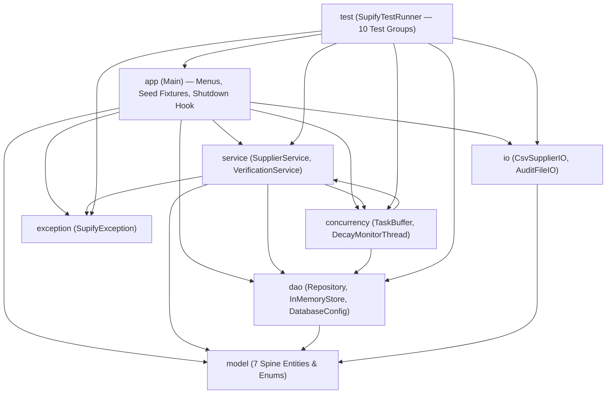
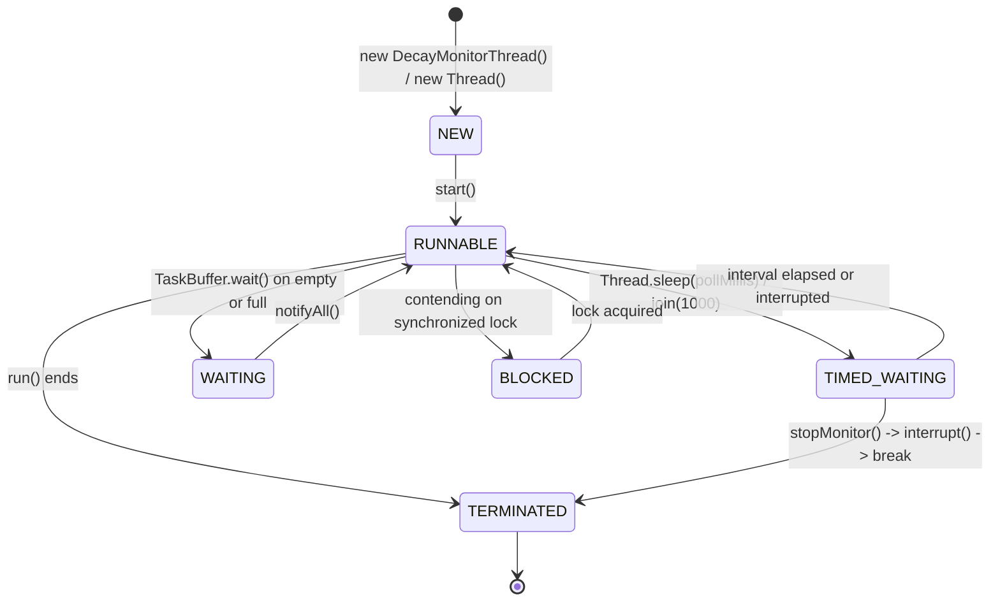

# Supify — Pure-Java Backend & Database Viva Preparation Guide

> **Complete Topic-by-Topic Revision Book | Plain-English Definitions + 92 Spoken Viva Q&As**  
> Aligned 100% to the simplified **20-file Java backend** (`backend/src/com/supify/`) and **MySQL 8.0 schema** (`db/`): 4-layer verification spine, OOP principles, multithreading, thread lifecycle, synchronization, `wait()`/`notifyAll()` inter-thread communication, Lambdas/Streams, Generics & wildcards, File I/O (`CsvSupplierIO`, `AuditFileIO`, `StreamTokenizer`), checked exceptions, and JDBC CRUD (`DatabaseConfig`, `JdbcSupplierDao`).

---

## Quick Start: 30-Second Pitch & Live CLI Demo Path

### 30-Second Viva Pitch

> *"Supify is a B2B supplier discovery and verification backend written in Java. Any supplier can type 'we hold ISO 9001', and a buyer cannot cheaply tell if that is real or still valid. So instead of a fake `boolean isVerified` flag, we built a **4-layer verification spine**: a Supplier submits a **Claim** with **Evidence**; an independent Verifier writes an immutable **VerificationCheck**; and on PASS, the platform issues a time-bounded **Attestation** that automatically expires in the background via our daemon thread (`DecayMonitorThread`)."*

Two phrases examiners love:
- **Asymmetry Razor:** *"Every feature cuts either the cost of **finding** a supplier or the cost of **trusting** one."*
- **Authority Split:** *"The supplier asserts (`Claim` + `Evidence`); the platform attests (`VerificationCheck` + `Attestation`)."*

### Live CLI Demo Path (`backend\`)

- **Run Interactive CLI:** `run.bat` (compiles & launches `com.supify.app.Main` with `-cp "bin;lib\*"`)
- **Run Automated Tests:** `test.bat` (runs `SupifyTestRunner` — **10 PASSED, 0 FAILED**)

| Menu Action | Keys to Press | What Happens Live |
| :--- | :--- | :--- |
| **Buyer Discovery & Compare** | `Main → [1]` (`[1]`, `[2]`, `[3]`, `[4]`) | `[1]` Lists all 5 seeded suppliers sorted by score; `[2]` runs Stream filter search; `[3]` opens `SUP-1`'s 4-layer Claim → Evidence → Check → Attestation chain; `[4]` compares 2 suppliers side by side |
| **Supplier Intake & 30s Decay** | `Main → [2]` (`[1]`, `[2]`, `[3]`) | `[2]` Submits a new claim + PDF evidence (`CLM-145`); `[3]` prints live expiry timers (`SUP-1`'s capacity claim counts down from 30s and fires an alert via `DecayMonitorThread`) |
| **Verifier Approve / Reject** | `Main → [3]` (`[1]`, `[2]`) | `[1]` Lists pending `SUBMITTED` claims; `[2]` records immutable `VerificationCheck`, creates active `Attestation`, and recalculates `Supplier` trust score & `TrustBand` immediately |
| **System & Admin Tools** | `Main → [4]` (`[1]`–`[6]`) | `[1]` Active JVM Thread States (`RUNNABLE`, `TIMED_WAITING`), `[2]` `TaskBuffer` worker check (`wait`/`notifyAll`), `[3]` CSV export/import (`data/suppliers.csv`), `[4]` Audit log byte stream (`data/audit.log`), `[5]` `StreamTokenizer` rule parser, `[6]` MySQL JDBC status |

---

## Topic 1: Problem Framing, Domain Model & 4-Layer Verification Spine

### 1.1 Quick Definitions

- **Domain Entity:** A business object with a stable identity (`Supplier.id = "SUP-1"`, `Claim.id = "CLM-101"`).
- **Immutable Object:** An object whose fields cannot change after creation (`public final class VerificationCheck`, all fields `private final`, no setters).
- **Separate Write Authority:** Preventing suppliers from writing verifier checks or attestations; suppliers only assert claims and upload evidence.
- **Time-Bounded Attestation (Decay):** A verified standing carrying `validUntil` that automatically expires (`ACTIVE → EXPIRED`) when time runs out.

### 1.2 How Supify Models the 4 Layers (`com.supify.model`)

1. **Layer 1 — `Claim`:** Stores `id`, `supplierId`, data-driven `claimTypeKey` (e.g. `"gst"`, `"iso_9001"` — no hardcoded `switch (claimType)`), `label`, `pillar`, `value`, and `status` (`"SUBMITTED"`, `"VERIFIED"`, `"REJECTED"`, `"EXPIRED"`).
2. **Layer 2 — `Evidence`:** Linked to `claimId`; stores `id`, `title`, `docType`, and `filePath`.
3. **Layer 3 — `VerificationCheck` (`final`):** Immutable verdict storing `id`, `claimId`, `VerificationMethod`, `outcome` (`"PASS"`/`"FAIL"`), `verifierName`, `LocalDateTime checkedAt`, and mandatory `note`.
4. **Layer 4 — `Attestation`:** Created only when approved (`"PASS"`); stores `validUntil = verifiedAt.plusSeconds(validSeconds)`, `state` (`"ACTIVE"`, `"EXPIRED"`, `"REVOKED"`), `isExpired()`, and `synchronized boolean expireIfNeeded()`.

### 1.3 Method Rigor Weights & Trust Capping Rules (`SupplierService.recalculateTrust`)

Each `VerificationMethod` enum carries a rigor weight:
- `SELF_DECLARED` (`0.25`) · `DOCUMENT_REVIEW` (`0.60`) · `THIRD_PARTY_API` (`0.85`) · `HUMAN_AUDIT` (`0.95`) · `SITE_VISIT` (`1.00`).

`SupplierService.recalculateTrust(supplierId)` sums scores of **`ACTIVE`** attestations only (`avgScore = Math.min(1.0, total / Math.max(3, activeCount))`), then applies 4 capping rules:
1. No active `IDENTITY` attestation → **`UNVERIFIED`** (`avgScore ≤ 0.30`).
2. Active `IDENTITY`, missing active `LEGAL` → **`BASIC`** (`avgScore ≤ 0.65`).
3. Both present + at least one `HUMAN_AUDIT` or `SITE_VISIT` + `avgScore ≥ 0.85` → **`AUDITED`**.
4. Otherwise → **`VERIFIED`**.

### 1.4 Primary WHY Behind Model Choices

| Choice | What It Does | Primary WHY We Picked It (vs. Alternative) |
| :--- | :--- | :--- |
| **4 Entities vs. `boolean isVerified`** | Separates claim, proof, check, attestation | A boolean hides *method*, *verifier*, *rationale*, and *expiry* |
| **`String claimTypeKey` (Data-driven)** | Stores `"gst"`, `"iso_9001"` as strings | Adding a new certification needs zero Java code or `switch` edits |
| **`final VerificationCheck`** | Removes all setters & subclassing | Guarantees audit history cannot be altered once recorded |
| **30-second expiry on `SUP-1`** | `verifyClaim(..., 30)` in `Main.seedSuppliers` | Lets you watch live background expiry inside a short viva demo |

### 1.5 Viva Questions — Topic 1 (Q1–Q10)

**Q1. What problem does Supify solve, and what is the Asymmetry Razor?**  
*Spoken Answer:* Buyers cannot cheaply verify if supplier claims are true or still valid today. Our **Asymmetry Razor** states every feature must cut either the cost of finding or the cost of trusting a supplier.

**Q2. Why not use a simple `boolean isVerified` field inside `Supplier`?**  
*Spoken Answer:* A boolean cannot express *how* a claim was verified (`SELF_DECLARED` vs `SITE_VISIT`), *who* approved it, *why*, or *when it expires*. The 4-layer spine makes trust explainable and time-bounded.

**Q3. Trace all 4 classes of your verification spine.**  
*Spoken Answer:* `Claim` (what the supplier asserts) → `Evidence` (uploaded document) → `VerificationCheck` (immutable verifier verdict) → `Attestation` (time-bounded active standing with `validUntil`).

**Q4. Why is `VerificationCheck` marked `public final` with no setters?**  
*Spoken Answer:* Once a verifier records PASS or FAIL with a written `note`, that audit decision must remain tamper-proof. Marking the class `final` and every field `private final` enforces immutability at compile time.

**Q5. How do you enforce "separate write authority" between supplier and verifier?**  
*Spoken Answer:* `VerificationService.submitClaim(...)` only writes `Claim` and `Evidence`. Only `verifyClaim(...)` (called from Verifier Console `[3]`) can construct `VerificationCheck` and `Attestation`.

**Q6. What happens if a supplier gets `SITE_VISIT` quality verified without verifying `IDENTITY` first?**  
*Spoken Answer:* `SupplierService.recalculateTrust` checks `hasIdentity` first and caps their standing at `TrustBand.UNVERIFIED` with `trustScore ≤ 0.30` until an active `IDENTITY` attestation exists.

**Q7. Why do `TrustBand` (`UNVERIFIED(0)..AUDITED(3)`) and `VerificationMethod` store numeric values in enums?**  
*Spoken Answer:* Storing `level` in `TrustBand` lets `SupplierService.search` filter by `minBand.getLevel()`, and storing `score` in `VerificationMethod` avoids `if/else` chains when scoring rigor.

**Q8. How does `SUP-1` drop from `AUDITED (0.85)` to `VERIFIED (0.80)` after 30 seconds?**  
*Spoken Answer:* When the 30-second `CAPABILITY` (`SITE_VISIT = 1.00`) attestation expires, active attestations drop from 4 to 3 (`(0.85 + 0.60 + 0.95) / 3 = 0.80`), falling below the `0.85` `AUDITED` threshold.

**Q9. What happens when a verifier clicks Reject (`FAIL`)?**  
*Spoken Answer:* `verifyClaim` passes `approved = false`, records an immutable `VerificationCheck` with outcome `"FAIL"`, passes `attestation = null` to `InMemoryStore.recordDecision`, and marks `Claim.status = "REJECTED"`.

**Q10. Why keep claim type in `String claimTypeKey` instead of creating subclasses per certification?**  
*Spoken Answer:* Creating classes like `Iso9001Claim` and `GstClaim` would require recompiling Java every time a new compliance certificate is added. Keeping `claimTypeKey` as data makes the domain extensible without code changes.

---

## Topic 2: Core OOP Principles, 8-Package Architecture & Patterns

### 2.1 Quick OOP Definitions

- **Class & Object:** A **class** is the blueprint (`Supplier.java`); an **object** is a live heap instance created via `new Supplier(...)`.
- **Abstraction:** Defining *what* operations exist while hiding *how* storage works (`Repository<T, ID>` hides `HashMap` inside `InMemoryStore` vs SQL inside `JdbcSupplierDao`).
- **Encapsulation:** Hiding internal fields as `private` and guarding state changes through methods (`Claim.setStatus`, `Attestation.expireIfNeeded`).
- **Inheritance (`IS-A`):** Extending a parent class to reuse structure and lifecycle (`DecayMonitorThread extends Thread`, `SupifyException extends Exception`).
- **Polymorphism ("Many Forms"):**
  - *Compile-time (Overloading):* Same name, different parameters (`SupifyException(String)` vs `SupifyException(String, Throwable)`).
  - *Runtime (Overriding):* Subclass customizes parent/interface method resolved dynamically at runtime (`@Override run()` in `DecayMonitorThread`, `@Override save/findById` in both `InMemoryStore` and `JdbcSupplierDao`).
- **Composition (`HAS-A`) vs. Inheritance:** Using fields to hold collaborating objects (`VerificationService` *has* `InMemoryStore`, `SupplierService`, and `TaskBuffer` injected via constructor).
- **Low Coupling & High Cohesion:** Each package has one clear responsibility (high cohesion) and communicates cleanly through narrow service/repository contracts (low coupling).

### 2.2 Clean 20-File Package Architecture (`backend/src/com/supify/`)



### 2.3 Primary WHY Behind Architecture Choices

| Pattern / Choice | Where Used | Primary WHY We Picked It (vs. Alternative) |
| :--- | :--- | :--- |
| **8 Packages (20 files)** | `app`, `model`, `dao`, `service`, `concurrency`, `io`, `exception`, `test` | Keeps clear separation of concerns while staying compact enough to inspect every class in minutes |
| **Repository Interface** | `Repository<T, ID>` implemented by `InMemoryStore` & `JdbcSupplierDao` | Allows the exact same `Supplier` entity & `Predicate` filtering across memory and MySQL |
| **Constructor Injection** | `SupplierService(store)`, `VerificationService(store, service, queue)` | Lets `SupifyTestRunner` create fresh isolated stores per test with zero static global conflicts |
| **`synchronized recordDecision`** | `InMemoryStore` | Keeps Check + Attestation + Claim update atomic without locking complexity |

### 2.4 Viva Questions — Topic 2 (Q11–Q18)

**Q11. Demonstrate all 4 OOP pillars directly in your 20 Java files.**  
*Spoken Answer:* **Abstraction:** `Repository<T, ID>` hides storage details. **Encapsulation:** `private` fields with controlled methods in `Supplier`/`Attestation`/`TaskBuffer`. **Inheritance:** `DecayMonitorThread extends Thread` and `SupifyException extends Exception`. **Polymorphism:** `@Override` methods on `Repository` (`InMemoryStore` vs `JdbcSupplierDao`) plus overloaded `SupifyException` constructors.

**Q12. Give one example each of compile-time and runtime polymorphism in your backend.**  
*Spoken Answer:* Compile-time overloading: `SupifyException(String message)` vs `SupifyException(String message, Throwable cause)`. Runtime overriding: `DecayMonitorThread` overrides `Thread.run()`, and `InMemoryStore`/`JdbcSupplierDao` override `Repository.save()`/`findAll()`.

**Q13. Why inject `InMemoryStore` via constructors instead of making its maps `public static`?**  
*Spoken Answer:* Constructor injection lets `SupifyTestRunner` instantiate completely isolated `InMemoryStore` objects in each of its 10 tests so test runs never pollute each other or the live CLI.

**Q14. Why does `InMemoryStore.nextId("CLM")` exist?**  
*Spoken Answer:* Generating clean sequential IDs (`CLM-101`, `EVD-102`, `SUP-1`) keeps CLI input short and readable during live demos instead of forcing users to type 36-character UUID strings.

**Q15. What is the difference between Composition (`HAS-A`) and Inheritance (`IS-A`) in Supify?**  
*Spoken Answer:* `VerificationService` **has** an `InMemoryStore` and `TaskBuffer` (composition) to orchestrate workflow cleanly without inheriting store internals, while `DecayMonitorThread` **is a** `Thread` (inheritance).

**Q16. Why keep domain classes in `model/` free of `Scanner` or `System.out` calls?**  
*Spoken Answer:* Keeping UI I/O inside `Main` and business logic in `service/` ensures the same `Supplier`, `Claim`, and `SupplierService` classes work equally well from `SupifyTestRunner` or any future UI.

**Q17. How does `Supplier.toString()` make CLI code cleaner?**  
*Spoken Answer:* Overriding `toString()` formats aligned columns (`id | name | city | category | trustBand (score)`) inside `Supplier` itself so `Main` can print lists simply via `System.out.println("  " + s)`.

**Q18. Why build `SupifyTestRunner` without JUnit?**  
*Spoken Answer:* Pure Java with zero test framework JARs compiles and runs via `test.bat` on any machine with JDK 17+ (`javac` + `java`).

---

## Topic 3: Multithreading & Background Daemons (`DecayMonitorThread`, `Main`)

### 3.1 Quick Definitions

- **Program:** Passive compiled `.class` bytecode sitting on disk (`backend/bin/`).
- **Process:** A running OS instance (`java.exe`) with its own private memory space.
- **Thread:** An execution path inside a process; multiple threads **share heap objects** (`InMemoryStore`) while keeping separate call stacks.
- **Multiprogramming vs. Multithreading:** Switching CPU across *separate processes* vs running *concurrent threads inside one process*.
- **Concurrency vs. Parallelism:** Concurrency structures multiple tasks cleanly (`Main` CLI + `DecayMonitorThread`); parallelism executes them simultaneously on separate CPU cores.
- **Daemon Thread:** A background worker (`setDaemon(true)`) that never blocks JVM shutdown once user threads (`main`) finish.

### 3.2 How Supify Uses Threads

1. **`DecayMonitorThread extends Thread`:**
   - Constructor sets `"Supify-DecayMonitor"`, `setDaemon(true)`, and `setPriority(Thread.NORM_PRIORITY - 1)`.
   - `run()` loops `while (running && !isInterrupted())`, calling `checkExpiredAttestations()` and `Thread.sleep(pollMillis)` (`4000ms` in `Main`).
   - When an attestation expires, it calls `claim.setStatus("EXPIRED")`, triggers `supplierService.recalculateTrust(...)`, and buffers a message via `synchronized addAlert(...)`.
   - `stopMonitor()` sets `running = false`, calls `interrupt()`, and calls `join(1000)` to wait up to 1 second for clean completion.
2. **Shutdown Hook (`Runnable` lambda) in `Main`:**
   - `Runtime.getRuntime().addShutdownHook(new Thread(() -> monitor.stopMonitor(), "Shutdown-MonitorStop"));` stops the daemon cleanly even on `Ctrl+C`.

### 3.3 Primary WHY Behind Threading Choices

| Method / API | What It Does | Primary WHY We Picked It (vs. Alternative) |
| :--- | :--- | :--- |
| **`start()` vs `run()`** | Spawns a new JVM thread | Calling `monitor.run()` directly runs the infinite loop on `main` and blocks the CLI menu forever |
| **`setDaemon(true)`** | Marks thread as background daemon | Must be set before `start()`; prevents JVM from hanging open after `main` exits |
| **`interrupt()` in `stopMonitor()`** | Wakes sleeping daemon immediately | Avoids waiting up to 4 full seconds inside `Thread.sleep(4000)` during shutdown |
| **`join(1000)`** | Waits max 1s for thread to end | Lets an active decay/recalculate scan finish cleanly instead of cutting off mid-update |
| **`volatile boolean running`** | Direct main-memory read/write | Stops `DecayMonitorThread` from caching `running = true` in a CPU register after shutdown |

### 3.4 Viva Questions — Topic 3 (Q19–Q28)

**Q19. Difference between Program, Process, and Thread in Supify?**  
*Spoken Answer:* `backend/bin` is the compiled program; running `run.bat` creates one OS process; `main` and `Supify-DecayMonitor` are threads inside it sharing the same `InMemoryStore` heap object.

**Q20. What happens if you write `monitor.run()` instead of `monitor.start()`?**  
*Spoken Answer:* No new thread starts! `main` executes `run()`'s infinite `while` loop itself, so the interactive CLI menu never appears.

**Q21. Why call `setDaemon(true)` before `monitor.start()`?**  
*Spoken Answer:* Calling `setDaemon(true)` lets the JVM exit automatically once `main` finishes; calling it *after* `start()` throws `IllegalThreadStateException`.

**Q22. Why does `DecayMonitorThread` restore `interrupt()` inside `catch (InterruptedException e)`?**  
*Spoken Answer:* When `InterruptedException` fires, Java clears the thread's interrupt flag back to `false`. Calling `interrupt()` again restores that status cleanly before breaking out of the loop.

**Q23. Trace all 3 steps inside `DecayMonitorThread.stopMonitor()`.**  
*Spoken Answer:* Step 1 sets `volatile running = false`. Step 2 calls `interrupt()` to wake it immediately out of `Thread.sleep(4000)`. Step 3 calls `join(1000)` so `main` waits up to 1 second for clean exit.

**Q24. How did you use both `extends Thread` and `Runnable`?**  
*Spoken Answer:* `DecayMonitorThread extends Thread` for long-running periodic monitoring with `stopMonitor()`, while `Main`'s shutdown hook and `SupifyTestRunner`'s producer/consumer workers pass `Runnable` lambdas directly to `new Thread(() -> ...)`.

**Q25. Why buffer alerts inside `DecayMonitorThread` instead of calling `System.out.println` directly?**  
*Spoken Answer:* Printing from a background thread while the user is typing at `Scanner.nextLine()` scrambles console prompts. Buffering alerts and calling `drainAlerts()` before printing the menu keeps terminal I/O clean.

**Q26. What does `setPriority(Thread.NORM_PRIORITY - 1)` do?**  
*Spoken Answer:* It sets priority to `4` (below `main` at `5`) as a gentle hint to the OS scheduler so background scanning doesn't interfere with interactive user input.

**Q27. Does `DecayMonitorThread` leak stale alerts after `drainAlerts()`?**  
*Spoken Answer:* No — `drainAlerts()` copies pending messages into a new list and calls `alerts.clear()` atomically inside a `synchronized` method.

**Q28. Why keep `checkExpiredAttestations()` as a separate helper called inside `run()`?**  
*Spoken Answer:* It isolates one scan cycle cleanly, keeping `run()` focused solely on loop timing, sleep, and interrupt handling.

---

## Topic 4: Thread Lifecycle & Scheduling (`Thread.State`)

### 4.1 Quick Definitions

- **Thread Lifecycle:** The 6 defined JVM states (`Thread.State`): `NEW`, `RUNNABLE`, `BLOCKED`, `WAITING`, `TIMED_WAITING`, `TERMINATED`.
- **Scheduling & Context Switching:** The JVM/OS scheduler swaps CPU cores among `RUNNABLE` threads rapidly, saving and restoring thread registers/stacks.
- **Live Thread Inspection (`DecayMonitorThread.printThreadStates()`):** Enumerates active threads via `Thread.enumerate(threads)` and prints `name`, `getState()`, `getPriority()`, and `isDaemon()` (seen live in `Main → [4] → [1]`).



### 4.2 Viva Questions — Topic 4 (Q29–Q35)

**Q29. Name all 6 states in Java's `Thread.State` enum.**  
*Spoken Answer:* `NEW`, `RUNNABLE`, `BLOCKED`, `WAITING`, `TIMED_WAITING`, and `TERMINATED`.

**Q30. Why is `"Supify-DecayMonitor"` almost always in `TIMED_WAITING` when you press `[4] → [1]`?**  
*Spoken Answer:* Checking expired attestations takes under a millisecond, and then the thread spends 4 seconds inside `Thread.sleep(4000)`, which puts it in `TIMED_WAITING`.

**Q31. Explain `BLOCKED` vs `WAITING` vs `TIMED_WAITING`.**  
*Spoken Answer:* `BLOCKED` means trying to enter a `synchronized` method held by someone else. `WAITING` means paused indefinitely in `wait()` (`TaskBuffer.consume()`) until `notifyAll()`. `TIMED_WAITING` has an automatic timeout (`Thread.sleep(4000)` or `join(1000)`).

**Q32. Why does `printThreadStates()` allocate `new Thread[Thread.activeCount() * 2]` before `Thread.enumerate()`?**  
*Spoken Answer:* `Thread.activeCount()` is an estimate at one instant; allocating double size prevents missing threads spawned right before `enumerate` runs.

**Q33. Why doesn't Java separate "Ready" and "Running" states?**  
*Spoken Answer:* Because OS time-slicing switches threads between ready and running in microseconds; from Java's view both mean "eligible to execute" (`RUNNABLE`).

**Q34. What happens if you call `start()` twice on a thread that is already `TERMINATED`?**  
*Spoken Answer:* Java throws `IllegalThreadStateException` — a terminated thread cannot be restarted.

**Q35. How can a thread in `Main` enter `WAITING` state?**  
*Spoken Answer:* When `Consumer` calls `TaskBuffer.consume()` on an empty queue (or `Producer` calls `produce()` on a full queue), `wait()` parks it in `WAITING` until `notifyAll()` wakes it.

---

## Topic 5: Shared Data, Race Conditions & Synchronization

### 5.1 Quick Definitions

- **Race Condition:** Unpredictable bug when two threads read/write shared objects simultaneously without coordination.
- **Critical Section:** Code touching shared mutable data (`InMemoryStore.recordDecision`, `SupplierService.recalculateTrust`, `TaskBuffer`).
- **Mutual Exclusion (`synchronized`):** Ensuring only one thread executes a monitor-protected method/block on an object at a time.
- **Atomicity vs. Visibility:** **Atomicity** means multi-step changes happen all-or-nothing (`recordDecision`); **visibility** means updates made by one thread are seen immediately by others (`volatile` / `synchronized`).

### 5.2 How Supify Prevents Race Conditions

| Mechanism | Where Used | Primary WHY We Picked It (vs. Alternative) |
| :--- | :--- | :--- |
| **`synchronized` on `InMemoryStore`** | All map/list getters & `recordDecision` | Prevents `ConcurrentModificationException` and keeps Check + Attestation + Claim update atomic |
| **`synchronized` `recalculateTrust`** | `SupplierService` | Stops concurrent verification + decay from computing and overwriting stale scores |
| **`synchronized` entity mutators** | `Claim.setStatus`, `Attestation.expireIfNeeded`, `Supplier.setTrustBand/Score` | Safe when `DecayMonitorThread` and `Main` read/update the same object references |
| **`volatile boolean running`** | `DecayMonitorThread` | Guarantees instant cross-thread visibility of shutdown signal without blocking |

### 5.3 Viva Questions — Topic 5 (Q36–Q43)

**Q36. Give one concrete race condition that could occur in Supify without `synchronized`.**  
*Spoken Answer:* Without synchronization on `recordDecision` and `recalculateTrust`, `DecayMonitorThread` could iterate over `attestations` while `VerificationService` inserts a new one (causing `ConcurrentModificationException`) or overwrite a newly updated `TrustBand` with an old score.

**Q37. Why do we synchronize `InMemoryStore.recordDecision(...)` as one method instead of locking each map individually?**  
*Spoken Answer:* Saving `VerificationCheck`, saving `Attestation`, and marking `Claim.status = "VERIFIED"` must happen atomically together so no reader ever sees a verified claim without its check/attestation.

**Q38. What lock does a `synchronized` instance method acquire? What about a `synchronized` static method?**  
*Spoken Answer:* An instance method locks `this` (that specific `InMemoryStore` or `TaskBuffer` instance). A static `synchronized` method locks the `Class` object (`ClassName.class`).

**Q39. What is the difference between `volatile` and `synchronized`?**  
*Spoken Answer:* `volatile` only guarantees memory **visibility** for single reads/writes (`running = false`), not atomicity for compound actions. `synchronized` guarantees **both** mutual exclusion (atomicity) and memory visibility.

**Q40. Why does `InMemoryStore.findAll()` return `new ArrayList<>(suppliers.values())` instead of returning `suppliers.values()` directly?**  
*Spoken Answer:* Returning a defensive copy (`new ArrayList<>`) lets callers stream or iterate over suppliers safely after releasing `InMemoryStore`'s lock, preventing `ConcurrentModificationException`.

**Q41. Could `idCounter++` in `InMemoryStore.nextId()` skip or collide if it weren't `synchronized`?**  
*Spoken Answer:* Yes! `++` is a read-modify-write operation; two threads calling `nextId` without `synchronized` could read the same `100` and issue duplicate IDs.

**Q42. Why is `VerificationCheck` safe across threads without `synchronized` on its getters?**  
*Spoken Answer:* All of its fields are `private final` initialized in the constructor with no setters (immutable), so once safely published it can be read concurrently with zero locks.

**Q43. How do you avoid deadlock in `InMemoryStore` + `DecayMonitorThread`?**  
*Spoken Answer:* `DecayMonitorThread.checkExpiredAttestations()` fetches a copied list from `store.getActiveAttestations()`, releases the `store` lock immediately, and only then runs `expireIfNeeded()` and `recalculateTrust()`, avoiding nested multi-object lock cycles.

---

## Topic 6: Inter-Thread Communication (`wait()`, `notifyAll()`, Guarded Blocks)

### 6.1 Quick Definitions

- **Monitor Ownership:** Every Java object has an intrinsic monitor; calling `wait()` or `notifyAll()` *without* holding `synchronized` throws `IllegalMonitorStateException`.
- **Guarded Block (`while` loop):** Checking a condition in a `while` loop around `wait()` so threads re-verify the condition after waking up.
- **Spurious Wakeup:** A rare JVM wakeup without `notifyAll()` — handled cleanly only by `while`, never `if`.
- **Producer–Consumer Coordination (`TaskBuffer<T>`):** Bounded buffer letting Producer threads pause when full (`queue.size() == capacity`) and Consumer threads pause when empty (`queue.isEmpty()`).

### 6.2 Walkthrough of `TaskBuffer.java`

- `produce(T item)`: `while (queue.size() == capacity && open) wait();` → `queue.offer(item)` → `notifyAll();`.
- `consume()`: `while (queue.isEmpty() && open) wait();` → returns `null` if closed, else `T item = queue.poll()` → `notifyAll();`.
- `shutdown()`: sets `open = false` and calls `notifyAll()` so waiting threads wake and exit cleanly.

### 6.3 Viva Questions — Topic 6 (Q44–Q52)

**Q44. Why must `wait()`, `notify()`, and `notifyAll()` always be inside a `synchronized` block or method?**  
*Spoken Answer:* The calling thread must hold the object's monitor lock to inspect the condition safely and release/re-acquire the lock atomically. Calling them outside `synchronized` throws `IllegalMonitorStateException`.

**Q45. Explain `Thread.sleep()` vs `Object.wait()` using Supify.**  
*Spoken Answer:* `DecayMonitorThread` uses `Thread.sleep(4000)` to pause while **keeping any locks**. `TaskBuffer` uses `wait()` so the parked thread **releases its monitor lock**, letting the peer producer or consumer enter and call `notifyAll()`.

**Q46. Why does `TaskBuffer` use `while (queue.isEmpty() && open)` instead of `if (queue.isEmpty())`?**  
*Spoken Answer:* Two reasons: **spurious wakeups** (OS waking a thread spontaneously) and **competing consumers** (if `notifyAll()` wakes two consumers for 1 item, the second consumer must re-check `queue.isEmpty()` and wait again instead of polling `null`).

**Q47. Why use `notifyAll()` instead of `notify()` in `TaskBuffer`?**  
*Spoken Answer:* Both producers and consumers wait on the **same monitor lock** (`this`). `notify()` wakes just one random waiter — a producer could wake *another waiting producer* when a consumer needed waking, stalling progress! `notifyAll()` wakes all waiters so the right thread proceeds.

**Q48. What happens in `Main`'s `[4] → [2] Verification Queue Worker Check` (Producer-Consumer Demo)?**  
*Spoken Answer:* `TaskBuffer` has capacity `2` while Producer sends `Verify-Job-1..4`. Jobs 1 and 2 enter immediately, then Producer blocks on `wait()` until Consumer drains one job and calls `notifyAll()`, waking Producer cleanly!

**Q49. How does `TaskBuffer.shutdown()` stop hanging threads when the CLI exits?**  
*Spoken Answer:* Calling `shutdown()` sets `open = false` and invokes `notifyAll()`, waking any thread waiting inside `produce()` or `consume()` so it sees `!open` and exits gracefully.

**Q50. Why throw `IllegalArgumentException` if `TaskBuffer` capacity is `<= 0`?**  
*Spoken Answer:* A bounded queue with capacity 0 or negative can never accept items and would deadlock every `produce()` call on creation — failing fast in the constructor prevents that bug immediately.

**Q51. Does `wait()` release ALL locks a thread holds, or only the monitor of that specific object?**  
*Spoken Answer:* Only the monitor lock on the object whose `.wait()` method is invoked! Other unrelated locks remain held (another reason `TaskBuffer` stays clean and standalone).

**Q52. Why check `if (queue.isEmpty() && !open) return null;` in `consume()`?**  
*Spoken Answer:* If `shutdown()` was called while items are still sitting in the queue, `consume()` drains remaining queued items cleanly first, and only returns `null` once empty and closed.

---

## Topic 7: Lambda Expressions, Functional Interfaces & Stream API

### 7.1 Quick Definitions

- **Functional Interface (SAM):** An interface with **Single Abstract Method** (`Predicate<T>`, `Function<T, R>`, `Comparator<T>`).
- **Lambda Expression:** Inline anonymous function syntax `(args) -> body` replacing multi-line anonymous inner classes.
- **Method Reference (`::`):** Concise syntax passing an existing method directly (`Supplier::getName`, `Supplier::getTrustScore`, `Supplier::getCategory`).
- **Stream:** A lazy, single-use, non-mutating pipeline over a collection (**Source** `.stream()` → **Intermediate ops** `filter/map/distinct/sorted/skip/limit` → **Terminal op** `collect/findFirst`).
- **Lazy Evaluation:** Intermediate operations record what to do without looping until a terminal operation runs (`collect()`).

### 7.2 How `SupplierService` Uses Lambdas & Streams

1. **Dynamic Filter Composition:** `Predicate<Supplier> filter = s -> true;` chained dynamically via `.and(...)` for keyword, category, `minBand`, and `minCapacity`.
2. **Stream Search Pipeline (`SupplierService.search`):**
   ```java
   return store.findAll().stream()
           .filter(filter)
           .distinct()
           .sorted(comparator)
           .skip(offset)
           .limit(pageSize)
           .collect(Collectors.toList());
   ```
3. **Distinct Sorted Categories (`SupplierService.getAllCategories`):**
   `store.findAll().stream().map(Supplier::getCategory).distinct().sorted().collect(Collectors.toList())`.

### 7.3 Viva Questions — Topic 7 (Q53–Q62)

**Q53. Which Functional Interfaces are used in Supify?**  
*Spoken Answer:* `Predicate<T>` (`SupplierService.search`, `Repository.findMatching`), `Function<T, R>` (`Repository.mapList`), and `Comparator<T>` (`SupplierService.getComparator`).

**Q54. Give three examples of Method References (`::`) in your code.**  
*Spoken Answer:* `Supplier::getCategory` in `getAllCategories()`, `Supplier::getTrustScore` and `Supplier::getName` in `getComparator()`, and `Supplier::getName` in `SupifyTestRunner` / `Main` with `Repository.mapList(...)`.

**Q55. Explain Stream Laziness with an example from `SupplierService`.**  
*Spoken Answer:* Calling `.filter()`, `.map()`, and `.skip()` doesn't iterate a single supplier by itself. Only when `.collect(Collectors.toList())` executes does the pipeline pull elements — and `.limit(pageSize)` stops pulling as soon as the page fills.

**Q56. What is the difference between a `Collection` and a `Stream`?**  
*Spoken Answer:* A `Collection` (`List`, `Map`) stores elements in memory for repeated access and mutation. A `Stream` holds **no data**, is **single-use** once terminated, and never mutates the underlying `InMemoryStore`.

**Q57. List all 6 Stream intermediate operations used in `SupplierService`.**  
*Spoken Answer:* `filter()`, `map()`, `distinct()`, `sorted()`, `skip()`, and `limit()`.

**Q58. How does `SupplierService.getComparator` support reverse sorting cleanly?**  
*Spoken Answer:* It builds a descending comparator with `Comparator.comparingDouble(Supplier::getTrustScore).reversed()` and `Comparator.comparingInt(Supplier::getCapacityPerMonth).reversed()`, or alphabetical ascending via `String.CASE_INSENSITIVE_ORDER`.

**Q59. Why use `skip(offset).limit(pageSize)` instead of `list.subList(from, to)`?**  
*Spoken Answer:* `list.subList` crashes with `IndexOutOfBoundsException` if `offset` goes past the end or the final page has fewer items. `skip().limit()` handles short final pages and empty results safely.

**Q60. Can you reuse the same `Stream` object after calling `.collect()`?**  
*Spoken Answer:* No — calling a terminal operation closes the stream; reusing it throws `IllegalStateException: stream has already been operated upon or closed`.

**Q61. What does `filter = filter.and(...)` accomplish in `SupplierService.search`?**  
*Spoken Answer:* It combines only the non-empty search criteria provided by the user into one `Predicate`, avoiding nested `if/else` loop branches.

**Q62. What does `.findFirst()` do in `InMemoryStore.getActiveAttestationForClaim`?**  
*Spoken Answer:* `.findFirst()` is a short-circuiting terminal operation returning `Optional<Attestation>` as soon as the first matching `ACTIVE` attestation is found.

---

## Topic 8: Generics, Type Safety, Diamond Operator & Wildcards

### 8.1 Quick Definitions

- **Generics (`<T>`):** Parameterizing interfaces/classes/methods with type variables so invalid types fail at **compile time** instead of runtime `ClassCastException`.
- **Diamond Operator (`<>`):** Letting Java infer type arguments (`new TaskBuffer<>(100)`, `new ArrayList<>()`) cleanly.
- **Wildcards & PECS (*Producer Extends, Consumer Super*):**
  - `? super T` (Consumer): Accepts predicates/mappers written for parent classes of `T`.
  - `? extends R` (Producer): Allows returning narrower subtypes cleanly.
- **`Optional<T>`:** Wrapper object representing explicit presence or absence without silent `NullPointerException`.

### 8.2 Generics in `Repository.java` & `TaskBuffer.java`

- `public interface Repository<T, ID>`: Generic across entity type `T` (`Supplier`) and primary key `ID` (`String`), implemented by both `InMemoryStore` and `JdbcSupplierDao`.
- `List<T> findMatching(Predicate<? super T> filter);`: Contravariant `? super T` wildcard.
- `static <T, R> List<R> mapList(List<T> items, Function<? super T, ? extends R> mapper)`: Generic static method using **both** `? super T` and `? extends R` (demonstrated cleanly with `Repository.mapList(imported, Supplier::getName)`).
- `public class TaskBuffer<T>`: Generic bounded producer–consumer buffer (`TaskBuffer<Claim>` for claim review, `TaskBuffer<String>` for worker check demo).

### 8.3 Viva Questions — Topic 8 (Q63–Q70)

**Q63. How do Generics improve type safety in `Repository<T, ID>` and `TaskBuffer<T>`?**  
*Spoken Answer:* Without generics, collections stored `Object` requiring risky casts prone to runtime `ClassCastException`. Parameterizing `Repository<Supplier, String>` and `TaskBuffer<Claim>` enforces exact types at compile time.

**Q64. Show a Generic Class, Generic Interface, and Generic Method in your project.**  
*Spoken Answer:* Interface: `Repository<T, ID>`. Class: `TaskBuffer<T>`. Method: `static <T, R> List<R> mapList(List<T> items, Function<? super T, ? extends R> mapper)` inside `Repository.java`.

**Q65. What is the Diamond Operator `<>`, and where did you use it?**  
*Spoken Answer:* Writing `new HashMap<>()`, `new ArrayList<>()`, or `new TaskBuffer<>(100)` omits repeating generic types on the right side while keeping full compile-time type checking.

**Q66. Explain `? super T` and `? extends R` (PECS) in `Repository.mapList`.**  
*Spoken Answer:* PECS means *Producer Extends, Consumer Super*. `mapper` **consumes** `T` (so `? super T` allows mappers expecting a superclass) and **produces** `R` (so `? extends R` allows returning a subclass cleanly).

**Q67. Why does `Repository.findById` return `Optional<T>` instead of returning `null`?**  
*Spoken Answer:* Returning `null` leads to hidden `NullPointerException` bugs. `Optional<T>` forces callers to handle missing records explicitly via `.isEmpty()`, `.ifPresent()`, or `.orElseThrow(...)`.

**Q68. Can Java generics hold primitive types like `int` (`TaskBuffer<int>`)?**  
*Spoken Answer:* No — Java generics require reference types due to type erasure, so we use wrapper classes (`Integer`, `Supplier`, `Claim`, `String`).

**Q69. Why does `TaskBuffer<T>` work for both `TaskBuffer<Claim>` and `TaskBuffer<String>`?**  
*Spoken Answer:* Because the synchronization logic (`wait()`/`notifyAll()`) doesn't care what object `T` is — keeping `TaskBuffer<T>` generic avoids duplicating queue code.

**Q70. What happens if two classes implement `Repository<Supplier, String>`?**  
*Spoken Answer:* Both `InMemoryStore` and `JdbcSupplierDao` share the exact same generic CRUD contract, guaranteeing consistent method signatures across in-memory and MySQL backends.

---

## Topic 9: File I/O (`CsvSupplierIO`, `AuditFileIO`, `StreamTokenizer`) & Exceptions

### 9.1 Quick Definitions

- **Character Stream (`FileReader`/`FileWriter`):** Transfers 16-bit Unicode characters for human-readable text (`CsvSupplierIO`, wrapped in `BufferedReader`/`BufferedWriter`).
- **Byte Stream (`FileInputStream`/`FileOutputStream`):** Transfers raw 8-bit bytes cleanly (`AuditFileIO` appending UTF-8 bytes in `append=true` mode and reading with a `byte[1024]` buffer loop).
- **`StreamTokenizer`:** Scans text from a `Reader` (`StringReader`) into classified tokens: `TT_WORD`, `TT_NUMBER`, ordinary `CHAR` operators (`>`, `<`, `=`), `TT_EOF`.
- **Checked vs. Unchecked Exception:** Checked (`SupifyException extends Exception`, `IOException`) **must** be caught or declared (`throws`); unchecked (`IllegalArgumentException`, `RuntimeException`) indicates programmer bugs.
- **Try-With-Resources (`AutoCloseable`):** `try (FileWriter fw = ...)` closes files automatically even if an exception occurs, preventing resource leaks.

### 9.2 Viva Questions — Topic 9 (Q71–Q82)

**Q71. Difference between Byte Streams and Character Streams in your backend?**  
*Spoken Answer:* `CsvSupplierIO` uses **Character Streams** (`FileWriter`/`FileReader` + `Buffered*`) for text rows (`readLine()`, `newLine()`). `AuditFileIO` uses **Byte Streams** (`FileOutputStream`/`FileInputStream`) writing/reading raw UTF-8 byte arrays cleanly.

**Q72. Why wrap `FileReader`/`FileWriter` inside `BufferedReader`/`BufferedWriter`?**  
*Spoken Answer:* Direct `FileReader` hits disk byte-by-byte; buffering batches I/O in memory and provides `.readLine()` / `.newLine()` needed for CSV row parsing.

**Q73. How does `CsvSupplierIO.importFromCsv` handle a corrupt/malformed line without crashing?**  
*Spoken Answer:* It checks `if (parts.length < 9) continue;` and wraps `Integer.parseInt`, `Double.parseDouble`, and `TrustBand.valueOf` inside `try/catch (IllegalArgumentException)`, logging a warning and skipping only that bad row while returning all valid suppliers.

**Q74. Why pass `true` in `new FileOutputStream(file, true)` inside `AuditFileIO`?**  
*Spoken Answer:* `true` opens the file in **append mode**, adding new audit lines to the end of `data/audit.log` instead of wiping previous logs every run.

**Q75. Explain how `AuditFileIO.readAuditByteLog` reads bytes safely.**  
*Spoken Answer:* It reads into a `byte[1024]` chunk buffer inside a `while ((bytesRead = fis.read(buffer)) != -1)` loop into `ByteArrayOutputStream` and converts the combined bytes with `StandardCharsets.UTF_8` so multi-byte characters never tear across chunk boundaries.

**Q76. Why configure `wordChars('_', '_')` and `ordinaryChar('>')`, `'<'`, `'='` in `RuleStreamTokenizer` / `AuditFileIO.tokenizeRule`?**  
*Spoken Answer:* Without `wordChars('_', '_')`, underscores split identifiers like `CAPACITY_MIN` into broken pieces, and setting `ordinaryChar` ensures `>=` splits into crisp `OP('>')` and `OP('=')` tokens around `TT_WORD` and `TT_NUMBER`.

**Q77. What tokens does `AuditFileIO.tokenizeRule("CAPACITY >= 50000 AND SCORE >= 0.80")` produce?**  
*Spoken Answer:* 9 tokens: `WORD(CAPACITY)`, `OP('>')`, `OP('=')`, `NUM(50000.0)`, `WORD(AND)`, `WORD(SCORE)`, `OP('>')`, `OP('=')`, `NUM(0.8)`.

**Q78. Why make `SupifyException` extend `Exception` instead of `RuntimeException`?**  
*Spoken Answer:* Extending `Exception` makes it a **checked exception**, forcing CLI menus and callers to handle missing supplier/claim errors via `try/catch` instead of letting invalid input crash the app unexpectedly.

**Q79. Why give `SupifyException` two constructors (`(String)` and `(String, Throwable)`)?**  
*Spoken Answer:* Supporting `(String message, Throwable cause)` enables **exception chaining**, letting a higher layer wrap a technical failure in a friendly message while keeping the original cause attached.

**Q80. Why is `try-with-resources` better than closing streams manually in `finally`?**  
*Spoken Answer:* `try (...)` closes every `AutoCloseable` resource automatically in reverse order, avoids null-check clutter, and keeps the original exception primary instead of masking it if `.close()` fails.

**Q81. Why sanitize commas (`clean(value)`) when exporting CSV?**  
*Spoken Answer:* Because `importFromCsv` splits rows on `,` (`line.split(",")`). Replacing any stray comma in fields ensures column counts always match `9` cleanly.

**Q82. How does `Main.readInt` handle invalid keyboard input safely?**  
*Spoken Answer:* It reads a full line (`nextLine()`), parses via `Integer.parseInt`, and catches `NumberFormatException` to return the default menu option instead of throwing `InputMismatchException`.

---

## Topic 10: JDBC, Relational Concepts & CRUD (`DatabaseConfig`, `JdbcSupplierDao`)

### 10.1 Quick Definitions

- **JDBC Architecture (`java.sql.*` + Type-4 Driver):** Standard Java interfaces (`DriverManager`, `Connection`, `PreparedStatement`, `ResultSet`) paired with MySQL's pure-Java Type-4 connector JAR (`backend/lib/mysql-connector-j-*.jar`) over TCP `3306`.
- **JDBC URL:** `jdbc:mysql://localhost:3306/supify?useSSL=false&allowPublicKeyRetrieval=true&serverTimezone=UTC` (`protocol:subprotocol://host:port/database?options`).
- **SQL Injection Prevention (`PreparedStatement`):** Binding inputs with `?` placeholders (`ps.setString(1, id)`) treats user text strictly as literal data, never executable SQL.
- **`ResultSet` Cursor & Typed Getters:** Row pointer starting *before* row 1; `if (rs.next())` / `while (rs.next())` advances rows and reads typed columns (`getString`, `getInt`, `getDouble`, `getLong`).

### 10.2 Exact Mapping Between `JdbcSupplierDao` & `db/schema/01_supify_schema.sql`

- **Relational Tables Used:** `organisation` (PK `id`, `legal_name`, `city`, ...) **1:1 joined with** `supplier_profile` (PK `id`, FK `organisation_id` with `ON DELETE CASCADE`, `category`, `capacity_per_month`, `moq`, `lead_time`, `trust_band`, `overall_trust_score`).
- **All 4 CRUD Operations (`JdbcSupplierDao`):**
  - **Create / Update (`save`):** Uses `INSERT ... ON DUPLICATE KEY UPDATE` via `PreparedStatement.executeUpdate()` across both `organisation` and `supplier_profile`.
  - **Read (`findById`, `findAll`, `count`):** Joins `organisation` and `supplier_profile`, runs `ps.executeQuery()`, and maps rows into `Supplier` objects inside `mapRow(ResultSet rs)`.
  - **Update (`updateTrust`):** Updates `trust_band` and `overall_trust_score` for an `organisation_id` via `ps.executeUpdate()`.
  - **Delete (`deleteById`):** Deletes from `organisation WHERE id = ?` (cascades cleanly to `supplier_profile` via foreign key `fk_profile_org`) and returns `ps.executeUpdate() > 0`.

### 10.3 Viva Questions — Topic 10 (Q83–Q92)

**Q83. Explain the 2 parts of JDBC architecture and how `DatabaseConfig` connects them.**  
*Spoken Answer:* Part 1 is the standard Java `java.sql` API (`DriverManager`, `Connection`, `PreparedStatement`, `ResultSet`). Part 2 is the Type-4 MySQL driver JAR in `backend/lib/`, loaded via `Class.forName("com.mysql.cj.jdbc.Driver")` before `DriverManager.getConnection(url, user, pass)`.

**Q84. Why use `PreparedStatement` instead of `Statement` in `JdbcSupplierDao`?**  
*Spoken Answer:* `PreparedStatement` binds inputs cleanly with `?` placeholders (`ps.setString`, `ps.setInt`), completely stopping SQL injection and handling special characters/types safely while pre-compiling the query.

**Q85. When do you call `executeQuery()` vs `executeUpdate()`?**  
*Spoken Answer:* `executeQuery()` runs read-only `SELECT` statements and returns a `ResultSet` cursor (`findById`, `findAll`, `count`). `executeUpdate()` runs `INSERT`, `UPDATE`, or `DELETE` and returns the affected row count `int` (`save`, `updateTrust`, `deleteById`).

**Q86. Walk through how `JdbcSupplierDao.findAll()` maps SQL rows back to Java objects.**  
*Spoken Answer:* Inside try-with-resources (`Connection`, `PreparedStatement`, `ResultSet`), it iterates `while (rs.next())` and calls `mapRow(rs)`, using typed getters (`rs.getString`, `rs.getInt`, `rs.getDouble`, `TrustBand.valueOf(...)`) to construct each `Supplier`.

**Q87. Why do both `JdbcSupplierDao.findById` and `deleteById` work cleanly with `organisation` + `supplier_profile`?**  
*Spoken Answer:* `supplier_profile.organisation_id` is a Foreign Key referencing `organisation.id` with `ON DELETE CASCADE`, so joining reads all fields cleanly and deleting the organisation removes its profile automatically.

**Q88. How does `JdbcSupplierDao.save` handle both Insert and Update in one call?**  
*Spoken Answer:* It uses MySQL's `INSERT INTO ... VALUES (...) ON DUPLICATE KEY UPDATE ...` so inserting a new supplier creates rows and saving an existing supplier updates them idempotently.

**Q89. Why does `DatabaseConfig` read `SUPIFY_DB_*` env variables / `-Dsupify.db.*` properties?**  
*Spoken Answer:* Never hardcode production database credentials in source code. Reading JVM properties or environment variables first lets anyone override URL/user/password without editing Java files.

**Q90. How does `JdbcSupplierDao` avoid leaking MySQL connections on an error?**  
*Spoken Answer:* Every `Connection`, `PreparedStatement`, and `ResultSet` is opened inside `try (...)` (try-with-resources), guaranteeing automatic closing even when `SQLException` occurs.

**Q91. What does `ON DUPLICATE KEY UPDATE` return or do, and why wrap `SQLException` into `RuntimeException` inside DAO overrides?**  
*Spoken Answer:* Because `Repository<T, ID>` is storage-neutral (`InMemoryStore` doesn't throw `SQLException`), checked `SQLException` cannot leak onto the interface signature cleanly — wrapping it with `new RuntimeException("...", e)` preserves the full cause without polluting domain services.

**Q92. Why did `Driver Available: true` appear in `[4] → [6]` even before running `setup_mysql.bat`?**  
*Spoken Answer:* Because `backend/lib/mysql-connector-j-26.10.0.jar` is already on `-cp "bin;lib\*"`, so `Class.forName` loads the driver cleanly; `testConnection()` accurately reports `Unknown database 'supify'` until `db/setup_mysql.bat` creates the schema.

---

## Two-Minute Last-Glance Cheat Table

| Concept / Topic | Exact Class(es) in Simplified `backend/` | One-Line Killer Summary |
| :--- | :--- | :--- |
| **4-Layer Spine (No Boolean)** | `Claim`, `Evidence`, `VerificationCheck (final)`, `Attestation` | Separates assertion from proof, immutable verdict, and `validUntil` expiry |
| **OOP Pillars & Patterns** | `Repository<T,ID>`, `InMemoryStore`, `JdbcSupplierDao`, `SupifyException` | Constructor DI + Abstraction + Overloading/Overriding + Composition |
| **Daemon Threads & Lifecycle** | `DecayMonitorThread` (4s) + `Main` Shutdown Hook | `setDaemon(true)`, `start()` vs `run()`, `sleep()`, `interrupt()`, `join(1000)`, `printThreadStates()` |
| **Synchronization & Visibility** | `InMemoryStore`, `SupplierService`, `DecayMonitorThread` | Atomic `synchronized recordDecision(...)` + defensive copies + `volatile running` |
| **`wait()` / `notifyAll()` Queue** | `TaskBuffer<T>` (`while` guarded blocks) | Handles spurious wakeups (`while`), avoids producer-wakes-producer deadlock (`notifyAll`) |
| **Lambdas & Streams** | `SupplierService` (`search`, `getAllCategories`) | `Predicate.and()`, `::` refs, lazy `filter/map/distinct/sorted/skip/limit` |
| **Generics & Wildcards (PECS)** | `Repository<T, ID>`, `mapList`, `TaskBuffer<T>` | `<T, ID>`, `<>`, `? super T` consumer & `? extends R` producer + `Optional<T>` |
| **Char/Byte I/O & Tokenizer** | `CsvSupplierIO`, `AuditFileIO`, `SupifyException` | Buffered CSV vs append-mode `FileOutputStream`/`FileInputStream` + `StreamTokenizer` + try-with-resources |
| **JDBC & CRUD Mapping** | `DatabaseConfig`, `JdbcSupplierDao` | `Class.forName`, `DriverManager`, `PreparedStatement` (`?`), `executeQuery`/`Update`, `ResultSet` |
